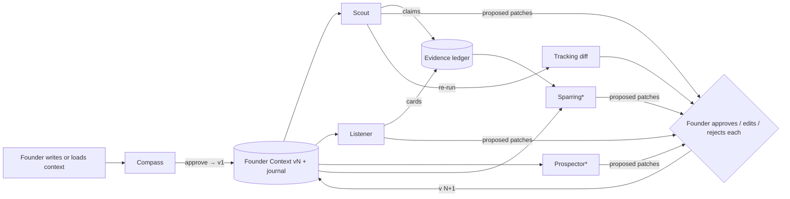
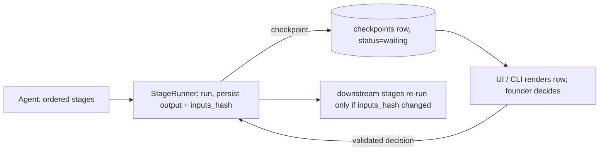
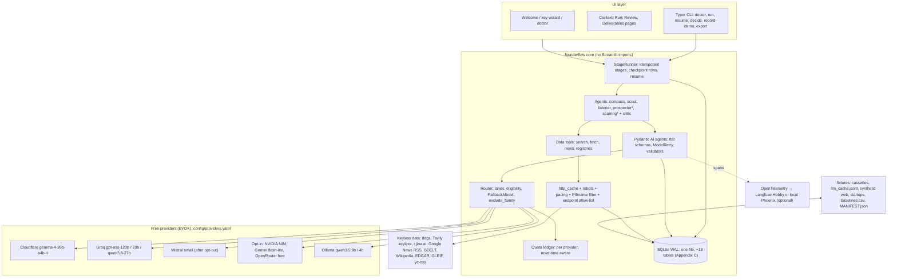

# FounderFlow AI — Design & Implementation Plan (v2, for owner approval)

**Subtitle:** evidence-ledger founder workflows that leave the deciding to you.
**Status:** plan for approval, no code written yet. **Date:** 2026-10-20. **Author:** FounderFlow AI project. Sources in Appendix F (consulted 2026-10-19; how they were checked is stated in A22).

> **TL;DR**
> 1. **What:** a local-first Python app (web UI + CLI) in which small, free AI models do the *gathering and structuring* of founder chores and the founder does the *deciding*; every claim is traceable to a URL, a verbatim quote and a date.
> 2. **For whom:** early-stage, non-technical founders (solo or small teams) who lose hours each week to market scans, competitor tracking, interview write-ups and first drafts.
> 3. **Agents (MVP):** **Compass** (messy description → versioned Founder Context with falsifiable assumptions), **Scout** (evidence-grounded market & competitor scan with tracking diffs), **Listener** (Mom-Test question linter + interview synthesis, offline-capable). **Stretch:** **Prospector** (company-level target list, no people data), **Sparring** (investor Q&A rehearsal + pre-mortem), weekly "what changed" review.
> 4. **Human in charge:** every run stops at database-backed checkpoints where the founder writes their own answer *before* seeing the agent's, accepts/challenges/edits each claim, approves every change to the Founder Context and records "what would change my mind". The agent never sends, posts, contacts, ranks for the founder or decides.
> 5. **Stack & cost:** Python 3.12, Pydantic AI 2.x, Streamlit + Typer, SQLite, keyless public data; all models free and bring-your-own-key (Cloudflare Workers AI and Groq by default, Mistral after a training opt-out, Ollama offline); a **replay demo needs no keys**. A Scout "light" run is capped at ~30K tokens; a 20-run demo day fits inside Cloudflare's free daily allowance alone (≈66%), Groq covers ≈18 of those runs, so the two no-training providers together give ≈1.9× headroom (section 8, Appendix D).
> 6. **Measured, not asserted:** every run logs agent time, rate-limit waiting, founder review time and founder thinking time separately against a timed manual baseline on the same synthetic brief. Headline: **time to a decision-ready brief vs. the baseline** with n, range and a quality panel; second tile: the **judging share** of the founder's minutes.
> 7. **Build:** one developer, ≈98 h minimum cut (Compass + Scout + replay demo + core UI), ≈129 h full MVP (Listener, docs, video, buffer). Which scope fits depends on your weekly hours and start date (table in section 14).
> 8. **Your decisions: section 16** (26 questions, defaults pre-filled). The first three gate everything: eligibility and hackathon rules, start date and hours, scope. Every hackathon fact here (deadline, eligibility, team size, format) is **unverified** until you confirm it on the listing.

> **How to read this document (15–20 minutes to approve).** Read the TL;DR; **section 3** (the summary table, then each agent's *Founder task*, *Checkpoints* and *Time saved*); **section 5** (how the agents connect); **section 8** (stack and model tables, skip the quota detail); **section 14** (milestones and the hours table); then answer **section 16**. The rest is reference: sections 6–7 and 9 for the developer; sections 10–13 are what judges will be shown; 17–18 hold assumptions, stage specifications, architecture detail, quota math, terms, the full risk register, sources and a glossary. A number labelled *hypothesis* has not been measured; a free-tier number carries its verification date; a hackathon fact is unverified until you confirm it.

---

## 1. Vision & problem

Founders lose hours every week on work that is necessary but not judgment: twenty tabs to check competitors' pricing, headlines pasted into a doc, the one-pager re-typed for every form, five interviews never written up, the forty investor questions rehearsed from memory. The brief asks for "time to think". Our reading is narrow and testable: **the agent prepares; the founder decides.** The agent may search, fetch, quote, structure, cross-check, diff and draft. It may never rank the founder's assumptions, declare "pursue" or "drop", change the founder's context document or take an external action. Where judgment is required it shows evidence *without* a verdict and asks for the founder's answer first.

Two findings shape the design. **AI research tools mis-cite far more than they appear to:** generative search engines fully supported only 51.5% of their sentences (Liu et al. 2023), paid deep-research products scored 78–90% citation accuracy (DeepResearch Bench), and a live-web benchmark found fabricated or expired URLs as a standard error class (Mind2Web 2). So every claim is a row in an **evidence ledger** (statement, URL, verbatim quote, fetched-at, source grade, support label) and the quote is verified in code, not trusted. **People who see an AI's answer first think less:** committing to one's own answer before the AI's is revealed reduced over-reliance (Buçinca et al. 2021); explanation without a recommendation produced learning while recommendation plus explanation did not (Gajos & Mamykina 2022); models flip answers under mild pushback 32–86% of the time (Sharma et al.), so a founder's disagreement must never flip a claim by itself. These are the mechanics of our **checkpoints**.

The remaining constraint is cost: no single free tier comfortably covers a demo day of multi-step runs (Appendix D), so the design is a *workflow with gates* that keeps runs small, routes steps across providers by budget, and ships an offline mode and a zero-key replay mode.

**Why not ChatGPT with browsing?** (the README's first line) A chat answer cannot show which of its 30 sentences are backed by a clickable quote, cannot stop and ask for your answer before giving its own, cannot diff this week's competitor pricing against last week's, cannot run on a laptop with no account, and cannot tell you how many minutes you spent judging versus collecting.

## 2. Who it is for & example scenarios

**Primary user:** a solo or two-person early-stage founder (idea to seed), comfortable with a browser, not a terminal, working in English (Q22). **Secondary:** hackathon judges and builders who reuse the tool with their own free keys.

**A — Mara, pricing decision (Scout).** Mara runs a two-person B2B SaaS for fleet-maintenance shops (fictional "Fathom Fleet") and must decide whether to add a free tier. She loads her Founder Context (v3), picks **Scout** "light" with the focus question "pricing and packaging". The **scope gate** shows the proposed queries and competitors, "6 searches, ~12 model calls, ~30K tokens ≈ 4% of today's Cloudflare quota", and asks for a one-line prior: *"Two of five have a free tier capped by vehicle count."* Eight minutes later the **claim review** shows 27 claims with quote, URL, date, grade and support label. Two competitors have free tiers; a third is "unverifiable" because its pricing page blocked the fetch. The critic (a different model) flags one "free tier" claim as a 2024 blog post; she challenges it, approving two extra searches, and the current pricing page is found. The brief states what the evidence does and does not show, with no recommendation. At the **decision gate** she writes: *"No free tier yet; alternative: 14-day trial. Would change my mind: a competitor converting free users at scale. Review in 6 weeks."* Time tile: agent 8 min, waiting 2, review 12, thinking 7; baseline median 2 h 40 min (owner-timed, 3 briefs); saved ≈2 h 10 min; judging share 66%.

**B — Yusuf, after five interviews (Listener).** He pastes notes labelled "Interview 1–5", roles only. The scrubber removes an email he missed and shows the redaction. Before any synthesis he types three bullets: *what did you hear?* Then the interview cards appear next to his bullets; two interviews are flagged "compliment-only, zero signal"; the critic notes his sample is all shop owners, no mechanics. He sets assumption A4 to "weakened", approves two context patches, exports guide v2. He ran it on Ollama: 11 minutes of model time, nothing left his laptop.

**C — Judge, zero keys (replay).** A judge clones the repo, runs one command, clicks **Try the demo** and within a minute is on Scout's claim review for the fictional company, replayed from recorded fixtures (badge: "Replaying recorded data from <date>"), with the decide-first box, critic diff and Time tile live in a per-session scratch database. No key, no network, no quota.

## 3. Features / the agents

Vocabulary: an **LLM step** is one model call with a *structured output* (JSON matching a declared schema, validated by code); a **tool step** is code calling a web or data source; **deterministic** is plain code. A **lane** is a routing class for model calls: *extract* (many small cheap calls), *judge* (one or two larger calls for planning and synthesis), *critic* (one call on a different model family). A **human checkpoint** writes the run's proposal to the database and stops; the founder's decision is written back and the run resumes. **TPM/TPD** = tokens per minute/day. "MVP" is built first; "stretch" only if time remains.

| Agent | Founder task | Checkpoints | Agent time | Founder time | Est. saving (hypothesis) | Scope |
|---|---|---|---|---|---|---|
| **Compass** | messy description → one-pager + falsifiable assumptions | C1 gaps, C2 decide-first, C3 approve | ~1 min | 10–15 min | 30–60 min, once per startup | MVP |
| **Scout** | 5–8 competitor scan with sources, repeatable as tracking | S1 scope, S2 decide-first + review, S3 decision | 6–12 min (12–20 on Groq alone) | 15–25 min | 1.5–3 h per scan | MVP |
| **Listener** | Mom-Test linting + synthesis of 5–10 interviews | L1 guide, L2 decide-first, L3 patches | 2–4 min cloud / 8–12 Ollama | 15–20 min | 40–90 min per batch | MVP |
| **Prospector** | 30–50 company-level targets, no people data | P1 weights, P2 decide-first review | 10–15 min | 15–25 min | 1.5–3 h | stretch |
| **Sparring** | investor Q&A rehearsal + pre-mortem + data room | V1 answer-first, V2 pre-mortem | ~5 min | unchanged by design | 30–60 min | stretch |

### 3.1 Compass — Founder Context intake & assumption mapper (MVP)

**Founder task & why it is real.** Turning a messy description into a structured one-pager (problem, customer, product, stage, geography, competitors) plus falsifiable assumptions. Founders redo this for every application and advisor, and the assumption list is rarely written down. It is the prerequisite for every other agent.

**Inputs.** Form fields (name, one-liner, stage, geography, business-model enum) and free text ≤1,500 words; demo mode preloads one of three fictional startups.

**Steps.** (1) *Deterministic:* validate; PII scrubber (emails, phones, @handles); ask for more text under 80 words. (2) *LLM, extract:* fill the draft; a field may be filled only if a sentence in the text supports it and the model returns that **verbatim sentence** (small models cannot count offsets), else null plus an open question. (3) *Deterministic:* locate each sentence by normalised substring; unfound → nulled and listed as a question; form fields override. (4) *LLM, extract:* 8–15 assumptions with category (customer, problem, product, market, channel, pricing, team), why-it-matters and a falsification test; the agent's riskiness ranking is **hidden**. (5) *Deterministic:* dedupe, cap 15, assign ids.

**Checkpoints.** **C1 fill the gaps:** answer open questions, edit fields next to the highlighted source sentence. **C2 decide-first:** pick the **three assumptions that scare you most** (three selects, not a full ranking) and write "… because …" before the agent's view is revealed; then both appear side by side with mismatches on those three and one sentence of rationale each. **C3 approve:** edit, delete, add; "who would dispute this?" required for the top three; approving writes **Founder Context v1** and a journal entry whose "what would change my mind" the founder completes.

**Critical-thinking features.** Unknown → question, never a guess; founder commits first; disagreement is the discussion object; falsification test per assumption; no verdict.

**Reasoning & sources shown.** Each field shows its source sentence highlighted; assumptions marked "derived from your text" or "agent inference"; the run log lists both calls (provider, model, tokens, prompt version).

**Data sources.** None external; Faker-seeded synthetic startups for demo.

**Time saved.** Baseline hypothesis 45–90 min, measured on the three synthetic briefs (section 12). Agent ≈1 min + 10–15 min editing; saving 30–60 min, the smallest and least certain, reused by every downstream run.

**Failure modes & limits.** Thin text → mostly nulls (the UI explains). Paraphrased sentence → field nulled, one repair retry. Pasted third-party names → regex cannot catch names; "I removed names of real people" checklist and the prompt replaces names with roles. Rubber-stamping prevented by ordering and logged think time.

### 3.2 Scout — Market & competitor evidence scan with tracking (MVP)

**Founder task & why it is real.** The recurring 2–4 hour scan of 5–8 competitors (pricing, features, positioning, news) before a pricing, positioning or fundraising decision, repeated every few weeks and rarely kept with sources. Named verbatim in the brief; most prior-art tools emit reports without a verifiable quote per claim.

**Inputs.** Founder Context vN (pinned); optional focus question; competitors (those named in the Founder Context plus ≤3 agent suggestions badged "unverified", dropped if their domain does not resolve); two positioning axes with defaults ("price vs. breadth", "SMB vs. enterprise") and a tooltip; preset **light** (≤6 pages, ≤6 searches, ≤30K tokens, ≤12 calls) or **standard** (≤12 pages, ≤8 searches, ≤45K tokens, ≤18 calls); optional pasted URLs; optional previous run id (tracking).

**How a run works** (14-stage specification in Appendix B.1):

```mermaid
sequenceDiagram
  participant F as Founder
  participant C as FounderFlow code
  participant M as Models
  C->>M: ScanPlan (judge): queries, competitors, 3 "how could this mislead?" checks
  M-->>F: S1 scope gate: edit plan, see quota cost, type a prior
  F->>C: approve (nothing fetched before this)
  C->>C: search → robots-aware fetch → momentum signals
  C->>M: ClaimExtraction per page (extract): ≤6 claims, verbatim quotes
  C->>C: verify quotes in code, grade sources by claim type, matrix with "unknown"
  C->>M: blind critic (other model family, shuffled claims)
  C->>M: MarketBrief (judge): stance enum, no recommendation (regex-enforced)
  M-->>F: S2: answer focus questions first, then claims vs evidence, critic diff
  F->>C: accept / challenge (reason, ≤2 extra searches) / edit
  C->>C: bounded re-search; labels never flip from pushback alone
  M-->>F: S3: pre-mortem, missing competitor, patches, journal
  F->>C: save → export unlocked
```

**Checkpoints.** **S1 scope gate** before any fetch: edit queries, competitors, axes; see the quota cost; type a one-line prior. **S2 decide-first + claim review:** answer each focus question in one line before reveal (the S1 prior is pre-filled; "I don't know yet" accepted and logged); then claims and matrix left, quote/URL/date/grade/label right; per claim Accept / Challenge (reason required) / Verify again / Edit (stored as grade-F founder assertions); tabs for critic diff, prior vs findings, "what we could not check", prompts & raw outputs. A challenge is the founder's approval for ≤2 extra searches; the button shows the cost and the ledger reserves it. **S3 decision gate:** pre-mortem (three agent-generated ways the scan could mislead plus ≥1 the founder writes); "what competitor is missing?"; ≤5 proposed patches ranked by evidence, each approved/edited/rejected, with "Reject all remaining"; journal entry (decision, alternatives, what would change my mind, review date). Export (Markdown brief, JSON evidence pack, matrix CSV) unlocks after save. No timers, no auto-continue; closing the browser leaves the run paused. **Express tracking re-run:** same scope → S1 is one confirmation click, S2 shows only changed cells, S3 only new patches.

**Critical-thinking features.** Prior replayed next to findings; stance enum instead of recommendations; blind critic that disagrees only by citing claim ids; disagreements as a diff; support labels and claim-type-relative grades instead of confidence percentages; "what we could not check" and the unverifiable count always visible; challenge requires a reason and buys new evidence; founder-authored pre-mortem; negative-space prompt; journal with review date.

**Reasoning & sources shown.** Per claim: URL, verbatim quote highlighted in the cached excerpt, fetched_at, licence, grade, label, agreement count, critic notes, founder decision. Brief sentences footnoted with claim ids. Per-step "show prompt & raw output". Limits panel: providers and models per step, tokens, fallbacks fired, pages blocked, sentences withheld by the name filter, oldest source date, citation-support rate, "data as of".

**Data sources.** Tier 0 (no key): ddgs ≥9.16 pinned; Tavily keyless mode; r.jina.ai (only where robots.txt permits); Google News RSS; GDELT DOC 2.0; HN Algolia; Wikipedia REST; SEC EDGAR full-text search and data.sec.gov; Apple iTunes Search. Tier 1 (optional free keys): Tavily, Exa. Backend order is configurable: ddgs is a metasearch scraper distributed "for educational purposes" and Google News RSS is an undocumented feed, so a ToS-clean path puts Tavily first (Q11). Excluded: G2/Capterra, LinkedIn, Reddit, Google Trends scrapers, Google Custom Search, Crunchbase, Brave (Appendix E).

**Time saved.** Baseline hypothesis 2–4 h for a 5-competitor scan with sources. With agent: 6–12 min wall on Cloudflare (12–20 min on Groq alone because of its 8K TPM window; waiting reported separately) + 15–25 min review across S1–S3 → ≈25–40 min to a decision-ready, cited brief; saving 1.5–3 h, more on tracking re-runs. Measured per section 12.

**Failure modes & limits.** Search soft-blocks (ddgs engines toggled three times in 2026) → Tavily keyless → cache → manual URLs with a "search degraded" notice. Sites that disallow or block the fetch → "unverifiable", never a guessed cell and never a proxy fetch around the block. Invented quotes → caught by the substring check. Groq 8K TPM → pacer waits. Critic and extractor agree on a wrong consensus → disclosed; the founder's prior is the third voice. Citation support on the live web will be well below 100% (published systems 51–90%); ours is a hypothesis until measured and is shown per run. Outputs are extractions from a handful of public pages, not market truth.

### 3.3 Listener — Question linter & interview synthesizer (MVP)

**Founder task & why it is real.** Writing interview questions that pass The Mom Test (past and specifics, not hypotheticals or pitches), then turning 5–10 interviews into evidence for or against the riskiest assumptions. Founders skip the synthesis. A survey of public repositories (October 2026) found no credible, free, checkpointed tool here. Offline-capable; no web data.

**Inputs.** Assumptions and segments from the Founder Context; planned questions; interview notes pasted one per interview, labelled "Interview n", roles only; demo ships Faker-seeded synthetic interviews labelled SYNTHETIC.

**Steps** (detail in Appendix B.2). (1) *Deterministic* linter (`config/momtest.yaml`) scores each question on past-vs-hypothetical, specific-vs-generic, about-them-vs-about-idea and shows the matched rule. (2) *LLM, extract, one batched call:* rewrites for flagged questions, shown **only on click**. (3) Interviews happen outside the tool. (4) *Deterministic:* on paste, pseudonymise and scrub, show the redaction preview, require "I removed names of real people"; notes route by default to the **privacy profile** (Groq, Cloudflare, Ollama; Ollama recommended). (5) *LLM, extract, one call per interview:* `InterviewCard` (segment, problems, frequency, severity 1–5, workaround, cost, verbatim quotes, commitment ∈ none/time/intro/money, bad-question count, compliment-only); quotes verified against the note. (6) *Deterministic:* tally by segment; signal score with visible, editable weights (`config/signal_weights.yaml`). (7) *LLM, critic:* alternative reading (selection bias, leading questions, small n) citing interview ids. (8) *LLM, judge:* guide v2, next three questions, proposed patches.

**Checkpoints.** **L1 guide approval:** rewrite flagged questions in your own words; one hypothesis for each of the ≤3 assumptions this round tests ("what result would make me drop this?"); export guide v1 and a note template. **L2 decide-first synthesis:** type "what did you hear? (3 bullets)" before reveal; then synthesis, critic and your bullets side by side; you set each assumption status. **L3:** patches, journal, export.

**Critical-thinking features.** On-demand rewrites; founder-authored hypotheses; decide-first synthesis; compliment-only interviews count as zero signal; the commitment ladder exposes "zombie leads"; visible weights; critic reading; sample-size honesty ("n=5, one segment").

**Reasoning & sources shown.** Every synthesis statement cites interview ids and quotes; linter flags show the rule; weights and rules are plain files linked from the UI; the export includes the pre-reveal bullets.

**Data sources.** The founder's own notes (local; sent only to the configured provider, disclosed first); synthetic interviews; no web calls.

**Time saved.** Baseline hypothesis 60–120 min to write up five interviews and a memo, 15–20 min per guide. With agent: 2–4 min (cloud) / 8–12 min (Ollama) + 15–20 min review → saving 40–90 min per batch. Both conditions reported.

**Failure modes & limits.** Names slip through the heuristic scrubber (disclosed; optional spaCy NER; offline recommended). Small models over-code "would be interested" as commitment → founder relabels. Synthetic interviews look cleaner than real ones (said on the demo page). Long notes chunked with a truncation notice. **Scope (assumes Q9's default):** the judged submission uses synthetic notes only; real anonymised notes are a local-only feature behind `FOUNDERFLOW_ALLOW_REAL_NOTES=1`, documented as outside the judged scope.

### 3.4 Prospector — Company-level target list, no people data (stretch)

**Founder task.** A first scored list of 30–50 target companies with evidence per company. Company-level only: no names, emails or profiles are retrieved, generated or stored; a "persona placeholder" is a role title; a generic channel (sales@, /contact) appears only if the company publishes it.

**Inputs.** ICP sketch; sources the founder enables: yc-oss static JSON with a field allow-list (name, website, one_liner, long_description, industry, batch, status, team_size, launched_at; `app_answers`, `question_answers` and founder fields dropped at load; fetched at runtime with attribution, never redistributed because its licence is unverified), GLEIF LEI API (CC0), UK Companies House `/search/companies` and `/company/{n}` only (officer and PSC endpoints absent from the code allow-list), SEC EDGAR tickers, a locally downloaded PDL Free Company Dataset subset (CC BY 4.0), optional GitHub token for org stats, Faker companies in demo; optional founder CSV with person-looking columns dropped locally.

**Steps.** (1) *LLM, judge:* ≤8 criteria, weights, knock-outs. (2) **P1:** founder edits them; nothing ranked before approval. (3) *Tool:* retrieval with filters, dedupe by domain/LEI, cap 150. (4) *Tool:* fetch `/` and `/pricing` for the top 40 (same fetcher and scrub). (5) *LLM, extract, 3 companies per ≤3K-token call:* per-criterion evidence quote or `insufficient_evidence`. (6) *Deterministic:* weighted score normalised to criteria with evidence, tiers A/B/C, coverage note. (7) **P2 decide-first:** founder names three expected top companies or types, then sees the list; prunes (reasons logged); re-tunes weights; answers "what kind of company is missing?"; approves CSV export.

**Time saved.** Baseline hypothesis 2–4 h for 40 companies with a reason each; agent 10–15 min + 15–25 min review. **Limits.** Registries are thin for private SMBs (GLEIF has no industry codes; yc-oss is startups only; PDL is multi-GB); many "unknown" cells; the UI explains why there are no names and links the public register for the founder's own lookup.

### 3.5 Sparring — Investor Q&A rehearsal & pre-mortem (stretch)

**Founder task.** Rehearsing the ~50 standard investor questions with evidence rather than assertion, finding untested assumptions, and a data-room checklist; decide-first is the whole mechanic.

**Inputs.** Founder Context, Scout's ledger, Listener cards, stage selection over `config/question_bank.json` (10 themes: problem/why now, market size & method, product & moat, traction & unit economics, GTM, competition, team, use of funds, risks, terms). Investor-firm matching only from a founder-loaded firm-level list (OpenVC CSV filtered to firm rows and columns; individuals and socials dropped at import; never redistributed). No outreach is ever drafted.

**Steps.** (1) *Deterministic:* select ~15 questions. (2) **V1, per question:** founder types the answer. (3) *LLM, critic lane:* label each claim `supported_by_ledger | asserted_without_evidence | contradicts_ledger` with claim ids (invalid ids dropped by code) plus "the follow-up a sceptical investor would ask". (4) *LLM, other-family critic,* on dispute only. (5) *LLM, judge:* pre-mortem, three reasons. (6) **V2:** founder adds ≥1 own reason, sets falsification tests, ticks the data-room checklist, approves export.

**Time saved.** Baseline hypothesis 90–150 min for 15 evidence-backed answers; typing is unchanged by design, the saving (~30–60 min) comes from evidence lookup and gap detection. **Limits.** A thin ledger yields mostly "asserted without evidence"; the UI suggests running Scout first.

### 3.6 Cross-cutting features and scope boundary

- **Replay demo mode (MVP):** zero keys, zero network, byte-identical, from recorded fixtures and a "synthetic web" of six fictional competitor sites with ground truth.
- **Decision journal (MVP):** every checkpoint decision (decision, alternatives, what would change my mind, review date) stored and exported.
- **Weekly review (stretch, designed now):** re-running Scout on the same scope diffs the ledger and surfaces only changed cells to a five-minute "is this change material?" checkpoint.
- **Stretch (X3):** History page with rubber-stamp detector and review-date reminders, Time & Limits page, share-safe export (journal fields stripped), workspace download/import.

**Out of scope, and why.** *Go-to-market drafting:* needs a populated ledger first; only a positioning paragraph with claim ids is planned (X3). *Meeting summaries:* offline tools such as Meetily already cover it; not differentiating. *Person-level lead generation and email finding:* excluded by the no-personal-data rule and platform terms. *Ideation:* Compass structures and stress-tests an idea the founder already has.

## 4. Traceability

| Feature | Brief requirement(s) | Judging criterion(ia) |
|---|---|---|
| Compass: structured context, founder-first assumption selection | "first drafts"; checkpoint; reasoning shown | Human judgment; UX |
| Scout evidence ledger (URL, quote, date, grade, label) | "shows its reasoning or sources"; "market scans, competitor tracking" | Business value; Documentation & responsible AI |
| Scope gate before any fetch; quota shown | checkpoint "before any decision or external action" | Human judgment; Frugality |
| Decide-first boxes (C2, S2, L2, P2, V1) | "reviews, challenges or validates"; "design for critical thinking" | Human judgment |
| Blind critic on another model family; challenge → new evidence | "challenges" | Human judgment; Reliability |
| Stance enum + regex ban on recommendations | "AI should not think for founders" | Human judgment |
| Listener linter + decide-first synthesis | "customer discovery" | Business value; Human judgment |
| Tracking diff + weekly review | "competitor tracking" | Business value |
| Prospector company-level only; endpoint allow-list in code | "lead generation"; "no personal data of third parties" | Responsible AI |
| Sparring answer-first; pre-mortem | "investor preparation" | Human judgment |
| Router, budget ledger, Cloudflare/Groq chain, Ollama | "free models only; no paid credits" | Frugality & accessibility; Reliability |
| Replay mode, synthetic web, run manifest | "robust and reproducible" | Reliability; UX |
| Time tile: time vs baseline, judging share, quality panel | "time saving is credible and measured" | Business value |
| `.env.example`, gitleaks, cassette scrubbing, session-only keys | "never publish API keys" | Responsible AI |
| LIMITS.md, data-use and ToS table, "what left this machine" | "honest about its limits" | Documentation & responsible AI |
| Three-button Welcome, key wizard, doctor | "founder can use it without help" | UX |
| GTM, meeting summaries, person-level leads out of scope (3.6) | mission list ends in "…" | — |

## 5. How the agents connect overall

**Shared object 1: Founder Context.** One Pydantic model stored as versioned JSON rows (version, parent, created_by ∈ {founder, approved_patch:<run_id>}, json, change_summary): company, problem, customer (segments with persona *role*, ICP), product, market (category, competitors, positioning axes), assumptions[] (id, statement, category, status ∈ untested/supported/weakened/refuted, founder_rank, agent_rank, evidence refs, falsification test, who would dispute, review date), decisions[] (the journal), open_questions[]. **Patches, not writes:** every agent emits `ProposedContextPatches` (JSON-pointer path, old, new, rationale, evidence ids); approved ops create version N+1 with provenance; rejected ops are remembered with the reason so they cannot be re-proposed without new evidence; each run pins the version it read and later shows a "stale against v4" badge.

**Shared object 2: the evidence ledger** (`claims` across runs). Downstream agents may cite only claims the founder accepted or verified.



**Handoffs.** Compass → v1 is mandatory; any agent can also run from a hand-written Founder Context v1 fixture (how the Scout golden run is recorded before Compass exists). Scout reads competitors, segments and market/pricing assumptions, writes claims, proposes competitor additions and status changes. Listener reads assumptions as hypotheses and proposes status changes with interview-id evidence. Prospector reads the ICP and competitor list and proposes ICP refinements from the founder's removals. Sparring reads everything and proposes only open questions. Any agent runs alone against v1 with degraded, labelled outputs.

**Why this gives time back for judgment.** The agents own retrieval, structuring, quoting, verification, diffing and bookkeeping (agent time). The founder's minutes go to designed thinking moments: scoping, committing to a prior, adjudicating disagreements, rewriting in their own words, recording what would change their mind; the Founder Context makes that thinking cumulative. Headline metric: *time to a decision-ready brief* vs. a manual baseline; second tile: the founder's *judging share*.

## 6. How we build the AI agents



**Anatomy.** An agent is a module declaring ordered **stages** `(name, kind ∈ {deterministic, llm, tool, checkpoint}, fn, input_schema, output_schema, lane, token_budget)`. The **StageRunner** runs them, persists each output with an `inputs_hash`, stops at a checkpoint by writing a row and returning, and resumes when the decision is written back; a changed decision invalidates only downstream stages. This is a *workflow with gates*: code decides what to fetch and when to stop; the model plans (as data the founder approves), extracts, verifies, critiques and synthesises.

**Structured output on every call.** A flat Pydantic schema (≤10 fields, enums, bounded lengths) as `output_type` in Pydantic AI through `OpenAIChatModel` with a per-provider base URL (not the `openai:` Responses prefix). Output mode per provider: Groq gpt-oss strict `json_schema` (NativeOutput); Mistral `json_schema`; Ollama grammar-constrained `format`; Cloudflare gemma-4 and OpenRouter prompted JSON plus validation (JSON mode is not listed for gemma-4). Validation failure → one `ModelRetry` carrying the error → failover → stage marked failed with a plain message and Retry. Semantic validators follow: quote present in page, claim ids exist, enums, no verdict vocabulary, PII regex.

**Tool calls are code-driven.** The model never chooses an endpoint, so page text cannot inject a call to `/officers`, fixtures replay every HTTP call, call counts are known before a stage starts (the ledger reserves budget), and small models are not asked for multi-step tool reasoning. The only loop is Scout's challenge pass, bounded to one iteration and two searches per claim.

**Checkpoint as a row.** The UI renders the row; the decision (approve/edit/challenge/reject, edited JSON, prior, "what would change my mind") is validated server-side against the stored proposal (status `waiting`, same workspace), transitions guarded in SQL, double-submit tested. Decide-first ordering is provable: `think_started_at` and `decided_at` are written before the agent's answer is unmasked. Survives refresh, reruns, host sleep and crashes.

**Independent critic.** A separate agent with its own prompt; receives claims with shuffled ids, never the synthesis or the founder's stance; drawn from a **different model family than this run's extract model** (and than the judge where three families exist) via `exclude_family=`; findings without claim ids are dropped; a mandatory field asks for "evidence I would want but do not see". One family configured → "critic independence reduced" badge.

**Why not one big prompt.** It cannot show which sentences are backed by a clickable quote, stop for the founder's answer and resume after a restart, stay under Groq's 8K tokens-per-minute cap, route cheap extraction and expensive synthesis to different free tiers, run a critic blind to the synthesis and the founder's stance, or be unit-tested and replayed step by step. MAST shows role sprawl and missing verification dominate multi-agent failures, so we keep three model roles per run and spend the budget on verification. Prompt rules and small-model tactics: Appendix B.3.

## 7. Architecture



**Data flow (Scout, live).** UI → `service.start_run(startup, 'scout', fc_version)` → plan → checkpoint S1 row → UI renders from DB → decision → resume → search/fetch/momentum (every HTTP call logged and cached) → per-page extraction (logged in `model_calls`, cached in `llm_cache`) → verification → critic → synthesis → S2 → challenges → bounded re-search → S3 → approved patches → Founder Context N+1 → export.

**Provider abstraction.** `config/providers.yaml` declares base URL, key env var, model ids per lane, quotas, reset time zone and flags (`trains_on_data`, `requires_phone`, `signup_notes`, `enabled_by_default`, `tos_note`, `verified_on`); the key wizard renders from it. Every cloud provider is an OpenAI-compatible endpoint, so adding one is a YAML entry. Per call the router assembles a `FallbackModel` from eligible candidates (key present ∧ enabled ∧ ledger budget ∧ not cooling down ∧ not excluded), `max_retries=0` on all but the last. `lane_set: cloudflare_only` drops to one provider if Groq changes its roster mid-event. State, caching, tracing and repository layout: Appendix C.

## 8. Tech stack

| Layer | Choice | Why | Free alternative |
|---|---|---|---|
| Runtime | Python 3.12; `uv` lockfile with exact pins; `requirements.txt` for pip/venv | Providers, Ollama and the UI are Python-first | pip + venv only |
| Agent framework | `pydantic-ai-slim[openai]==2.57.0`, all providers via `OpenAIChatModel` base URLs | Structured outputs with validation and `ModelRetry`, `FallbackModel`, `TestModel`/`FunctionModel`, OTel-native; releases every few days, so pin | LangGraph 1.2 + `langgraph-checkpoint-sqlite` 3.1 (`LANGGRAPH_STRICT_MSGPACK=true`), or `openai` SDK + Instructor |
| Routing / quotas | Own router (~300 lines) over `FallbackModel` + SQLite ledger with reset rules | Free limits differ in unit (RPD, TPD, TPM, neurons, monthly) and reset time | LiteLLM `Router` (SDK mode) |
| UI | Streamlit 1.66 multipage; `st.data_editor`; checkpoints rendered from DB rows then `st.rerun()` | Fastest founder-usable UI for one developer; the only Python UI with a zero-config, no-card free host (Community Cloud) | NiceGUI 3.x in Docker on Render free (cold starts); Typer CLI always available |
| CLI | Typer + Rich | Headless runs for CI, judges, evals; same gates | argparse |
| Storage | SQLite (stdlib, WAL), plain-SQL migrations; JSON/CSV exports | Zero infra, transactional, one file | DuckDB read-only over exported JSONL |
| HTTP + cache | `httpx`, own `http_cache`, `urllib.robotparser`, `trafilatura`; `vcrpy` 8.3 / `pytest-recording` 0.14 with secret scrubbing | Deterministic tests without network | `requests` + `requests-cache` 1.3 |
| Search / data | `ddgs==9.16.x`, Tavily keyless, Tavily key (order configurable); r.jina.ai; feedparser; GDELT; Wikipedia/Wikidata; EDGAR; GLEIF; yc-oss; iTunes Search | Free, mostly keyless; endpoint allow-list and `tos_note` per source | Exa credit; SearXNG profile; SerpApi 250/month |
| Validation / settings | Pydantic v2, `pydantic-settings` (.env → `st.secrets` → session), `rapidfuzz` | Schemas double as prompts, DB shapes, golden files | difflib |
| Synthetic data | Faker 40.x seeded 1337 + fictional startups + synthetic web | No third-party personal data; byte-identical demo | Hand-written JSON |
| Tests / evals | pytest, `TestModel`/`FunctionModel`, `ALLOW_MODEL_REQUESTS=False`, cassettes `record_mode=none`, `pydantic-evals` | CI never touches the network; judgment rules are tests | respx |
| Tracing | `model_calls` + per-run JSONL always; optional OTel → Langfuse Hobby or local Phoenix | Reasoning visible with no backend | Pydantic Logfire personal |
| Secrets | `.env.example`, `.gitignore`, gitleaks, cassette scrubbing, session-only keys | Hard requirement | detect-secrets |
| Offline inference | Ollama `qwen3.5:9b` (16 GB) / `4b` (8 GB), `gemma4:e4b` alt; `num_ctx` 8–16K; thinking off for extraction | Unlimited, private, grammar-constrained JSON | llama.cpp, LM Studio |
| Hosting | Local one-command baseline; Dockerfile + compose; `.devcontainer` for Codespaces (120 free core-hours); Community Cloud public demo in **replay-only** mode | Zero third-party dependence; one-click judge path; public URL spends no quota | Render free (Docker); HF Spaces, Railway, Fly, Cloud Run excluded (paid or card-gated) |

### Model strategy

| Lane | Primary | Fallbacks (in order) | Offline |
|---|---|---|---|
| **extract** (many small calls, thinking off, ≤3.5K in / ≤1K out) | Cloudflare `@cf/google/gemma-4-26b-a4b-it` | Groq `openai/gpt-oss-20b` → Groq `qwen/qwen3.8-27b` → Groq `openai/gpt-oss-120b` when its bucket has room → Mistral `mistral-small-latest` (after opt-out) → opt-in NVIDIA `openai/gpt-oss-20b` → opt-in OpenRouter `openrouter/free` (`data_collection: deny`) | Ollama `qwen3.5:9b` / `4b` |
| **judge** (plan, synthesis; 1–2 calls, ≤6K in / ≤1.5K out, reasoning low) | Groq `openai/gpt-oss-120b` | Cloudflare `gemma-4-26b-a4b-it` → Mistral `mistral-small-latest` → opt-in Gemini `gemini-3.1-flash-lite` (≤2 calls/run) → opt-in NVIDIA `openai/gpt-oss-120b` | Ollama `qwen3.5:9b` |
| **critic** (1 call, ≤4K in) | first available model from a **different family** than this run's extract model (gpt-oss ↔ gemma-4 ↔ mistral-small) | Cloudflare `@cf/zai-org/glm-4.7-flash` as an extra family | `gemma4:e4b` if installed, else same model with shuffled claims (badge) |

Per-call input caps are one rule everywhere: extract ≤3.5K, judge ≤6K, critic ≤4K; a judge call plus its 1.5K output nearly fills Groq's 8K TPM window, so a retried judge call on Groq waits for the next minute. Profiles: **balanced** (above), **privacy** (Groq, Cloudflare, Ollama), **offline** (Ollama), **replay** (no calls). Excluded by policy or availability: GitHub Models (retired 2026-07-30), Cerebras and SambaNova (card-gated or 20 RPD), Hugging Face Inference Providers (no free credits), Together/Fireworks (no free tier), OpenRouter $10 top-up (paid credits), Gemini Pro (no free tier), Gemini 3.x Flash (~20 RPD), Mistral medium/large (tight or unpublished caps).

**Quota conclusion for a 20-run demo day** (table in Appendix D): Cloudflare's 10,000 free neurons cover the day alone at ≈66%, no card, no phone, no training. Groq covers ≈18 of 20 runs under lane routing; the full day fits only if extraction spills onto `gpt-oss-120b` (≈88% of 600K TPD, no retry headroom), and its 8K TPM window stretches a Scout run to 12–20 minutes. Together ≈1.9× headroom; Mistral is a bonus, never load-bearing. The gemma-4 figures assume reasoning tokens can be disabled on Cloudflare; M1 verifies this with a probe and otherwise moves the extract lane to `@cf/qwen/qwen3-30b-a3b-fp8` (Q6). Search: 12 Scout runs × 6 queries = 72 ddgs calls/day at one per 2.5 s, cached 6 h, Tavily keyless fallback.

## 9. Reliability & error handling

- **Retries & failover.** ≤2 retries on 429/5xx/timeouts with jittered backoff honouring `Retry-After`, then a 60 s cooldown and failover. Non-retryable: 400 schema unsupported → switch output mode; 401/403 → provider disabled for the session with the fix shown; 402 (Mistral exhausted) → disabled until the month resets; 404/410 → disabled, doctor suggests an alternate. Tool outcomes are typed (`ok`, `blocked_by_robots`, `unreachable`, `rate_limited`) and flow into support labels; empty search results trigger the next backend.
- **Budget ledger.** Pre-call reservation of estimated tokens (chars/4 English, chars/3 French, corrected from provider `usage`) plus `max_tokens` plus a 30% output margin for reasoning tokens; RPM/TPM pacing before sending. Windows reset per provider (Groq, Cloudflare 00:00 UTC; Gemini midnight Pacific; Mistral monthly; OpenRouter per-account day).
- **Quota hit mid-run.** Run parks as `waiting_for_quota` with provider, next reset in local time and the offline option; "Resume" or `founderflow resume <run_id>` continues at the first incomplete stage; waiting logged separately.
- **Validation.** Every output is a Pydantic model plus semantic validators the model cannot fake; UI-edited JSON re-validated before persistence.
- **Resumable sessions.** All state in SQLite; idempotent stages; a run abandoned >24 h is marked abandoned (saved = 0) but resumable.
- **Reproducible demo mode.** `FOUNDERFLOW_MODE=replay` serves fixtures and cached responses with zero keys and network; `record-demo` regenerates with a reviewed diff; seeds, model ids and dependencies pinned; every run carries a manifest. CI's definition of done is a replayed end-to-end run asserting the evidence-pack hash, decide-first ordering, zero network calls and zero secrets in exports; the **golden run is recorded before the UI is finished**.
- **Tests & evals** (Appendix C.3): unit tests include the allow-list (`/officers` raises) and robots-disallow → no proxy fetch; integration covers resume after crash and double-submit; evals on ~20 synthetic scenarios measure quote-grounding, price accuracy, no PII, no verdict words, critic citations, canary-claim catch rate and prompt injection. A manual live-smoke workflow pings every Tier-0 endpoint and provider, because none has yet been exercised from this project.

## 10. Human judgment by design

| Checkpoint | Agent | Kind | What the founder does | Anti-rubber-stamp mechanism |
|---|---|---|---|---|
| C1 fill the gaps | Compass | review/edit | answers open questions, edits fields next to source sentences | unknown fields are questions, not defaults |
| C2 decide-first | Compass | decide-first | picks the three scariest assumptions and says why before the agent's view | ordering provable from timestamps; disagreement shown |
| C3 approve context | Compass | approve | edits, "who would dispute this?" for top 3, journal entry | required fields; version immutable |
| S1 scope gate | Scout | scope | edits queries/competitors/axes, sees quota cost, types a prior | nothing fetched before approval |
| S2 claim review | Scout | decide-first + review | answers focus questions, then accepts/challenges/edits claims, adjudicates critic diff | challenge needs a reason and buys new evidence; labels never flip from pushback |
| S3 decision gate | Scout | pre-mortem + journal | adds a failure reason, names a missing competitor, approves ≤5 patches, writes what would change their mind | export locked until saved |
| L1 guide approval | Listener | review/edit | rewrites flagged questions, writes ≤3 hypotheses | rewrites only on click |
| L2 decide-first synthesis | Listener | decide-first | writes "what did you hear?" before reveal; sets assumption statuses | agent proposes, founder sets |
| L3 patches + journal | Listener | approve | approves patches, journal entry | as S3 |
| P1 weights | Prospector | review/edit | edits criteria, weights, knock-outs | no ranking before approval |
| P2 list review | Prospector | decide-first + review | predicts top fits, prunes, asks "what is missing?" | removals logged with reasons |
| V1 answer first | Sparring | decide-first | types the answer to each question | grading exists only after the answer |
| V2 pre-mortem | Sparring | approve | adds own failure reason, sets tests | required contribution |

**UX of a checkpoint.** An amber card titled as a decision ("Which competitors matter?", "What is your answer before you see ours?", "How could this be wrong?"), a one-line "why this step exists" with the study behind it, an estimated think time, buttons that name the action, no timers, no default selection. Decide-first boxes accept "I don't know yet" and offer one explicit **Skip (logged)** (Q8); skips are surfaced back to the founder. **Over repeated use:** canary-claim evals during development; the stretch History page adds a rubber-stamp detector ("you accepted 98% of claims with a median think time of 4 s") and review-date follow-ups. The UI and docs say these designs were rated less convenient in the cited study, and that this is intentional.

**What the agent never does.** Writes to the Founder Context; declares pursue/drop or any verdict; ranks the founder's assumptions before the founder does; fetches outside the approved scope (a challenge is the approval for its ≤2 searches); contacts anyone, sends, posts, books or pushes to external tools; looks up individuals; exports before the decision gate; auto-continues on a timer; silently drops a challenged claim; shows a confidence percentage.

## 11. User experience

**Honest first-run numbers.** *Demo:* under 5 minutes from clone to the review screen. *Your own startup:* 20–30 minutes of setup (two free accounts; Cloudflare alone is enough to start) plus ≈15 minutes in Compass before the first Scout run, which then takes 25–40 minutes including review.

**Install paths.** (A) `install.sh` / `install.ps1` installs `uv`, syncs and launches at `localhost:8501`; (B) `docker compose up` (optional `--profile ollama`); (C) "Open in Codespaces". A public Streamlit Community Cloud URL runs **replay-only with no persistent writes**: each visitor gets a per-session temporary SQLite copied from fixtures and deleted on session end, so decide-first boxes work and nothing is shared between visitors; it accepts no keys. It may take ~1 minute to wake after 12 h idle, so the README leads with the local path.

**Screen 0 — Welcome.** **Try the demo** (default), **Use with my startup** (key wizard), **Fully offline** (Ollama detected, model suggested by RAM); five lines on what the tool does and does not do; "why not ChatGPT with browsing?"; in-progress runs with Resume.

**Key wizard.** One card per provider rendered from `providers.yaml`: purpose, link to the free key, signup requirements with verification date ("Cloudflare: no phone, no card; Groq: phone verification reported, verify at signup"), data policy in two lines (Mistral's card includes the opt-out link and an "I opted out" checkbox), a screenshot-guided Cloudflare token walkthrough, a **Test key** button (one-token call; remaining budget from provider headers where available — Groq, OpenRouter — else the local ledger's estimate, labelled as such). "Remember on this computer" (off by default) writes `.env` with 0600 permissions after a warning. A contact string is used only in the User-Agent for SEC/Wikimedia etiquette (Q13). **Doctor:** provider, status, resolved model ids, quota remaining or estimate, reset time. **Consent preview** once per provider and profile (with "don't show again") of which text goes where; the per-run "what left this machine" panel remains.

**Screens 1–4 (MVP).** *Founder Context:* form + text, C1–C3, version timeline with diffs. *Run:* task cards with expected agent time from the live ledger next to the baseline median; "Do it by hand first (start baseline timer)"; scope gate; `st.status` progress with budget meter and honest pacing waits ("waiting 40 s for Groq's per-minute window"). *Review:* decide-first card first; two columns (claims/matrix left, evidence drawer right); tabs for critic diff, prior vs findings, what we could not check, prompts & raw outputs; decision card. *Deliverables:* downloads (brief .md, evidence pack .json, matrix .csv), Time tile ("Baseline median 2 h 40 min (owner-timed, 3 briefs) · This run 29 min · Saved ≈2 h 10 min · Agent 8 · Waiting 2 · Review 12 · Thinking 7 · Judging share 66%"), quality panel, Limits panel; a minimal Settings page (keys, profile). **Stretch (X3):** Time & Limits, History, full Settings.

**Accessibility.** Labels and grades are text plus colour; per-claim actions are keyboard-reachable selects; errors pair what happened with one next action; plain reading level; English UI (Q22).

## 12. Measuring time saved

**Why not ask.** Developers in a randomised study forecast a 24% speed-up, perceived 20% afterwards, and were measured 19% slower (METR 2025). Self-report is a labelled secondary measure only.

**One study design (`benchmarks/protocol.md`; assumes Q12's default).** Three fictional briefs. For each, the owner performs Scout (hypothesis 2–4 h), Listener (1–2 h) and Compass (~1 h) manually with a stopwatch and only a browser: n = 3 briefs × 1 timer per agent, ≈12–20 h in week 5, counted **outside** the developer hours of section 14. A second team member (Q1, Q12), if any, adds a second timing and grades outputs with the pre-registered rubric (claims supported, checklist coverage, "unknown" honesty); otherwise the report carries "single rater" and "builder as participant" caveats. Agent condition: instrumented stage timestamps; **review and thinking time count as part of the agent condition**; the metric is "time to decision-ready brief", not "time to first draft". Report medians, ranges, n, failed and abandoned runs (saved = 0), rubric and citation-support rate side by side; raw CSV committed.

**Instrumentation.** `time_log` rows (run, stage, kind, started_at, ended_at) with four disjoint kinds: `agent_compute`; `waiting_rate_limit`; `human_review` (claim table, matrix, critic tabs); `human_think` (a decide-first, pre-mortem or journal box focused, `think_started_at` → `decided_at`). Idle gaps >10 min excluded. **Headline:** time to decision-ready brief vs. baseline median with n, range and a baseline-source label (in-app timer / time study / self-estimate / none). **Second tile:** judging share = (human_review + human_think) ÷ (agent_compute + waiting_rate_limit + human_review + human_think). No saving is ever shown without the quality panel.

**Reported honestly.** Small n, synthetic briefs, builder as participant, hypotheses replaced by measured values, cloud and Ollama conditions, the METR caveat next to every number. A pilot with 2–3 external founders is stretch.

## 13. Responsible AI, data & security

- **Personal-data rule, enforced in code.** Company- and document-level sources only; `config/sources.yaml` holds per-source endpoint and field allow-lists (Companies House company endpoints only; EDGAR issuer-level fields; Wikidata organisation properties; HN author dropped; yc-oss founder-prose fields dropped) and the model never chooses endpoints; domain deny-list (G2/Capterra family, LinkedIn, Reddit, X, app-store reviewer pages); path skip-list (`/team`, `/people`, `/careers`); PII scrubber (emails, phones, @handles) plus a **name-sentence filter** (two consecutive capitalised tokens, not at sentence start, not in the allow-list built from the Founder Context and page title; withheld sentences counted on the Limits panel; spaCy NER optional) on all fetched text and pasted notes. Residual risk disclosed. Lists in Appendix E.1.
- **Synthetic / public data.** Fictional startups, Faker companies and interviews, a synthetic web of six fictional sites (all labelled SYNTHETIC); committed fixtures only from licence-clear sources (Appendix E.2); synthetic interview notes only in the judged submission (Q9).
- **Secrets.** `.env.example` placeholders only; `.env`, `.streamlit/secrets.toml`, `data/` git-ignored; gitleaks in pre-commit and CI; cassettes scrub headers, query parameters, JSON-body keys and URL path ids, and CI greps cassettes for key patterns; keys never logged; session-only keys unless saved locally on request; the hosted demo holds none; exports and any workflow export contain none (Appendix E.3).
- **Provider and source terms, disclosed before the first call.** Groq: no training, logs ≤30 days. Cloudflare: no training. Mistral Free mode: may train unless opted out, "evaluation and prototyping" intent, enabled only after confirmation. Gemini free: content used to improve Google products, may not serve EEA/UK/CH end users, off by default. NVIDIA NIM: trial-only, prompts logged, off by default, never for notes. OpenRouter free: upstreams may train, `data_collection: deny` sent. Ollama: nothing leaves the machine. Search: ddgs is an educational-use metasearch scraper and Google News RSS an undocumented feed, both paced and cached and replaceable by Tavily first (Q11); r.jina.ai only where robots.txt permits (Appendix E.4).
- **Disclaimers (LIMITS.md, RESPONSIBLE_AI.md, in-app).** Outputs are extractions from a handful of public pages, not market truth; small models misread tables and invent quotes (caught, not eliminated); live citation support is well below 100% and the measured rate is shown per run and published from the eval set; web data and free tiers change monthly (quota table with verification dates and screenshots); the critic can agree with a wrong first pass; no confidence percentages; time-saved numbers come from small-n studies by the builder; checkpoints are deliberately less convenient; approvals are a cognitive checkpoint, not a security boundary; not legal, financial or investment advice. Streamlit telemetry disabled; caches have TTLs and a purge command.

## 14. Implementation plan

Hours are estimates for one developer with an AI coding assistant and include a 1.5× correction for the underestimation found when earlier drafts were re-checked against the feature list. **Minimum cut** (M0–M6, ≈98 h) must work end to end first; Listener, docs, video and buffer (M7–M9) complete the ≈129 h MVP; the owner's manual baselines (≈12–20 h, section 12) sit on top; stretch only after the golden run is green.

| Milestone | Deliverables | Definition of done | Hours |
|---|---|---|---|
| M0 Scaffold | uv/pyproject with pins, requirements.txt, `.env.example`, `.gitignore`, pre-commit (ruff, gitleaks), LICENSE, CI skeleton, Dockerfile, compose, devcontainer, `providers.yaml`/`sources.yaml` with `verified_on`, `tos_note`, signup notes | CI green; gitleaks blocks a planted key | 5 |
| M1 LLM layer | Router with lanes and eligibility, `FallbackModel` via `OpenAIChatModel`, per-provider output modes, ledger with reset rules and usage feedback, pacing, `llm_cache`, `model_calls`, `exclude_family`, doctor, non-retryable errors | Ledger window tests (UTC/Pacific/monthly), fallback order, cache keys; doctor runs against Cloudflare + Groq; 5-call probe shows gemma-4 emits no reasoning tokens and the Cloudflare dashboard's neuron count for those calls is within 20% of the ledger's estimate (else extract lane → `qwen3-30b-a3b-fp8` and/or the ledger's neuron rate corrected from the dashboard, Appendix D recomputed) | 14 |
| M2 Core state + spike | Schema and migrations, Founder Context versioning and patch engine, StageRunner with `inputs_hash` and resume, checkpoint rows with SQL-guarded transitions, time_log, manifest, export writers; **2–3 h Streamlit spike**: one page renders a TestModel checkpoint row, accepts Approve/Edit, writes the decision, resumes | Resume-after-crash and double-submit tests pass; spike page works | 11 |
| M3 Data layer | Search chain (order from config), robots-aware fetcher with robots-permitting jina fallback, trafilatura, scrubber + name filter, allow/deny lists, `http_cache`, Google News RSS, GDELT, HN, Wikipedia, cassette scrubbing, Tier-0 smoke script | `/officers` raises; robots-disallow → no proxy fetch; name filter on a pricing-table fixture; smoke script run once per endpoint | 9 |
| M4 Scout core | Schemas, prompts v1, stages 1–14, `FunctionModel` tests, eval scenarios | `founderflow run scout --brief fathom_fleet` completes through S3 in the CLI with recorded fixtures | 20 |
| M5 **Golden run** | Synthetic web (6 sites + ground truth), three fictional startups with **hand-written Founder Context v1 fixtures**, `record-demo`, replay mode, CI golden replay (pack hash, zero network, zero secrets) | CI replays Scout from `fixtures/startups/fathom_fleet/context_v1.json`, clickable through the spike page; fallback demo exists | 5 |
| M6a Compass core | Sentence grounding, hidden ranking, top-3 disagreement, C1–C3 via CLI, tests | Headless Compass produces v1 from fixture text; golden replay covers Compass + Scout | 8 |
| M6b Core UI | Welcome, key wizard, doctor, Founder Context page (C1–C3), Run page (S1, progress, budget meter), Review page (S2, two columns, critic diff), decision card (S3), replay badge, minimal Settings | Tester (Q17) completes "Try the demo" and a live Scout run from the README alone; else a recorded clean-machine run by the owner | 20 |
| M6c Deliverables | Downloads, Time tile, quality panel, Limits panel, "what left this machine", consent preview | Tile values reconcile with `time_log` and `model_calls` in a test | 6 |
| **Minimum cut** | | | **98** |
| M7 Listener | Linter + `momtest.yaml`, rewrites on click, L1–L3, InterviewCard with quote check, tally + `signal_weights.yaml`, critic, synthetic interviews, privacy default, anonymisation confirmation, real-notes flag | Runs in replay and on Ollama; evals green | 11 |
| M8 Study tooling & docs | `protocol.md`, `rubric.md`, in-app baseline timer, `baselines.csv` import, README (quickstart, quota table from providers.yaml, data-use and ToS table, "why not ChatGPT"), LIMITS.md, RESPONSIBLE_AI.md, ARCHITECTURE.md, Community Cloud replay deployment, Codespaces check | Time tile shows measured medians with n once baselines are imported; docs checked against the six criteria | 10 |
| M8b Video | 3-minute five-beat demo recorded from replay first (fallback), then live; edited, uploaded | Plays end to end; fallback cut exists | 4 |
| M9 Buffer & re-verification | Re-read every provider's limits page logged in, screenshots into README, bump pins, re-record fixtures and review drift, clean Codespace dry-run; **only if rules require a workflow export (Q3, Q25):** a runnable trimmed n8n sub-workflow (search → fetch → extract → Wait node), tested on n8n self-host, 2 h | Clean-machine run succeeds from the README alone | 6 |
| **MVP total** | | | **129** |
| X1 Prospector | Schemas, loaders with field allow-lists, scoring, P1–P2, CSV export, synthetic companies | Replay run; allow-list test covers every endpoint | 10 |
| X2 Sparring | question_bank.json, V1 loop, ledger grading, dispute re-grade, pre-mortem gate, data-room checklist | Invalid ids dropped in tests; V1 ordering provable | 8 |
| X3 Weekly review & extras | Tracking checkpoint, History / Time & Limits / full Settings, rubber-stamp detector, reminders, share-safe export, import/export, positioning paragraph, Langfuse switch, founder pilot, Kaggle notebook | Re-run surfaces only changed cells; pilot results in benchmarks/ | 16 |

**What the demo shows.** (1) "Try the demo" → Scout review in under a minute with zero keys; (2) a live Scout run: scope gate with quota cost, decide-first box, one challenge resolved by new evidence, critic diff, journal; (3) the Time tile and quality panel; (4) Listener on synthetic interviews on Ollama; (5) the Limits panel and "what left this machine".

**Calendar (assumes Q2's default: start Monday 2026-10-26, 25 h/week, pre-window work allowed; the 2026-12-18 deadline is unverified).**

| Week | Dates | Milestones | Demo-able at end of week |
|---|---|---|---|
| 1 | Oct 26 – Nov 1 | M0, M1, M2 start | doctor against Cloudflare + Groq |
| 2 | Nov 2 – 8 | M2 finish, M3, M4 start | spike page approves a TestModel checkpoint; Tier-0 smoke green |
| 3 | Nov 9 – 15 | M4 finish, M5, M6a | **golden Scout run replays in CI (fallback demo exists)** |
| 4 | Nov 16 – 22 | M6b, M6c | **minimum cut: live Scout run through the UI** |
| 5 | Nov 23 – 29 | M7, M8; owner's manual baselines (12–20 h, own time) | Listener on Ollama; Time tile with measured medians |
| 6 | Nov 30 – Dec 6 | M8b, M9 | **MVP complete; video; clean-machine run** |
| 7 | Dec 7 – 13 | X1 (X2 if green) | stretch demos |
| 8 | Dec 14 – 18 | final re-verification, submission ≥24 h early | submitted |

**What fits your hours** (weeks ≈ 7.7 from Oct 26, ≈ 6.4 from Nov 4 if pre-window work is not allowed):

| Hours/week | Start Oct 26 | Start Nov 4 |
|---|---|---|
| 25 | ≈190 h: full MVP + X1, maybe X2 | ≈160 h: full MVP + X1 |
| 15 | ≈115 h: minimum cut + Listener; docs compressed; study on 2 briefs | ≈96 h: minimum cut only; Listener and video fallback-only |
| 10 | ≈77 h: **reduced scope** — Scout + replay demo + Compass form-only (C1/C3, no C2) + Review and Deliverables pages; no Listener | ≈64 h: Scout + replay demo + CLI + one Review page; not recommended |

## 15. Risks & mitigations

Top risks; full register in Appendix E.5.

| Risk | Likelihood / impact | Mitigation |
|---|---|---|
| Hackathon rules unknown or unfavourable (eligibility, team size, pre-window work, "workflow export", deadline time zone) | Medium / **blocking** | Q1–Q3 before build; all hackathon facts labelled unverified; n8n sub-workflow budgeted only if required |
| Free-tier churn before demo day (Groq had three deprecation waves in 2026; Gemini cut Flash; Cerebras went card-gated; HF gated Spaces) | High / medium | Config-driven model ids, doctor probe, `lane_set: cloudflare_only`, replay demo, M9 re-verification with screenshots |
| Hours overrun (129 h MVP) | High / medium | 98 h minimum cut; golden run in week 3; hours table per scope; stretch gated |
| ddgs breakage; sites block agent fetches | High / medium | Empty = failure → Tavily keyless → cache → manual URLs; "unverifiable" labels; search cached 6 h; "search degraded" notice |
| Checkpoint fatigue | Medium / medium | Top-3 instead of full ranking, ≤3 hypotheses, pre-filled priors, ≤5 patches, consent once per provider, express re-run, logged Skip; disclosed |
| Time-saved credibility (small n, single rater, builder as participant) | Medium / medium | Pre-registered rubric, raw CSV, failed runs counted, caveats printed, in-app timer, pilot as stretch |
| Hosted demo mixes visitors' data or sleeps | Medium / high | Per-session temporary SQLite, no persistent writes, no keys; README leads with the local path |

## 16. Decisions I need from you

Defaults are pre-filled; "yes" needs no comment. Questions 1–4 gate everything else.

**Gating**

1. **Eligibility and team size.** Listing snippets say "college students only" and "teams of 2 to 4" (unverified). Are you an enrolled student, is a solo entry permitted, can you form a team? *Why:* a solo build may be ineligible; a second person changes the time study and usability test (Q12, Q17). *Default:* confirm on the listing before anything is built; the plan assumes a 1–2 person effort.
2. **Start date, pre-window work, weekly hours.** May work begin before the reported Nov 4 opening (unverified)? When do you start, how many hours per week? *Why:* section 14's calendar and reachable scope follow. *Default:* start 2026-10-26, 25 h/week, pre-window work allowed.
3. **Hackathon rules.** Paste the confirmed deadline and time zone, required artefacts (video length, meaning of "workflow export"), eligibility text, criteria weights. *Why:* sets M8b, M9 and the submission checklist. *Default:* 2026-12-18 (unverified), repo + ≤3-minute video, no workflow export.
4. **MVP scope.** Compass + Scout minimum cut, Listener third; Prospector, Sparring, weekly review stretch. *Why:* fixes ≈129 h and the demo story. *Default:* as proposed; under 15 h/week Listener is stretch; under 10 h/week the reduced scope in section 14.

**Build choices**

5. **Providers you will sign up for.** Cloudflare (no phone, no card), Groq (phone verification reported), Mistral (needs the training opt-out and acceptance of its "evaluation and prototyping" intent: yes/no), optional Gemini, NVIDIA, OpenRouter, Tavily, Exa, GitHub token. *Why:* sets the default chain and critic independence. *Default:* Cloudflare + Groq on; Mistral only after you confirm the opt-out; rest off.
6. **Cloudflare as the single-provider minimum.** Accept account ID + API token as the founder's minimum setup (screenshot-documented), and the extract-lane move to `@cf/qwen/qwen3-30b-a3b-fp8` with recomputed quota math if gemma-4 reasoning cannot be disabled? *Default:* yes.
7. **Your machine** (RAM, GPU, OS), willingness to download a ~7 GB Ollama model, Ollama in the demo? *Default:* 16 GB, no GPU → `qwen3.5:9b`; Ollama shown for Listener only.
8. **Gate strictness.** Decide-first boxes required with a logged Skip, or fully mandatory? *Default:* required with logged Skip.
9. **Real interview notes.** Judged submission on synthetic notes only; real anonymised notes local-only behind `FOUNDERFLOW_ALLOW_REAL_NOTES=1` (privacy profile, checklist, outside the judged scope)? *Why:* real notes describe identifiable third parties even when pseudonymised. *Default:* yes.
10. **Headline metric.** Time to decision-ready brief vs. manual baseline (criterion 1), judging share second? *Default:* yes.
11. **Search backend stance.** ddgs first (keyless, scrapes engine HTML, "educational use") with Tavily keyless fallback, or Tavily keyless first (cleaner terms, undisclosed caps)? Google News RSS stays as a paced undocumented feed either way. *Default:* ddgs first, order configurable, terms disclosed.

**Measurement and operations**

12. **Time study.** Will you run the manual baselines yourself (3 briefs × Scout, Listener, Compass; ≈12–20 h in week 5, outside developer hours)? Is there a second person to time or grade? Do you accept the "builder as participant" caveat? *Default:* yes, alone, single-rater caveat; otherwise two briefs.
13. **Contact string for the User-Agent** (SEC/Wikimedia etiquette; appears in cassettes and manifests unless scrubbed). Personal email or project alias? *Default:* project alias, scrubbed.
14. **Demo-day accounts.** Can you create a separate Cloudflare account and Groq organisation for development within each provider's terms, or is demo-date testing replay/Ollama only? *Default:* replay/Ollama only; no second accounts unless the terms clearly allow.
15. **Hosting and public repo.** Community Cloud needs a public GitHub repo during the build; do the rules allow public work before submission, and do you want the replay-only public URL? *Default:* yes to both if allowed; else local + Codespaces only.
16. **EEA audience?** *Why:* Gemini's free tier cannot serve EEA end users and trains on content. *Default:* assume EEA; Gemini off.
17. **Usability tester.** One non-technical person for a 20-minute test in week 4; if none, M6b's definition of done becomes a recorded clean-machine run by you. *Default:* recorded run by you.
18. **Stretch pages.** History (rubber-stamp detector, reminders), Time & Limits, full Settings, share-safe export, import/export stay in X3? *Default:* yes.

**Quick defaults (say no if you disagree)**

19. **Demo data.** Fictional companies in repo and video; your real context local only. *Default:* yes.
20. **Licence.** *Default:* MIT.
21. **Name.** Keep "FounderFlow AI" with the subtitle despite same-named repos? *Default:* keep.
22. **UI language.** *Default:* English; French README section if time allows.
23. **External tracing** (Langfuse Cloud Hobby, free, shareable traces) or local only? *Default:* local; Langfuse behind an env var for the video.
24. **Include Prospector at all**, given personal-data sensitivity and thin company-level data? *Default:* last stretch item; drop if short.
25. **Workflow export.** If required, a runnable trimmed n8n sub-workflow (2 h in M9) rather than a hand-written JSON of the whole app? *Default:* yes; none otherwise.
26. **Stack.** Python 3.12 + Streamlit + Typer CLI + SQLite. *Why:* every library and free host is Python-first; CLI-only fails "founder without help". *Default:* yes.

## 17. Assumptions made in this plan

Each assumption takes the default of the question named; dependent plan text says so.

| # | Assumption | Q |
|---|---|---|
| A1 | One developer from 2026-10-26 at 25 h/week; pre-window work allowed; the section 14 calendar follows | Q2 |
| A2 | The owner is eligible and a 1–2 person entry is permitted | Q1 |
| A3 | Deadline 2026-12-18, repo + ≤3-minute video, no mandatory workflow export; all hackathon facts unverified | Q3, Q25 |
| A4 | MVP = Compass + Scout + Listener; stretch as listed | Q4 |
| A5 | Cloudflare + Groq by default; Mistral after opt-out; Gemini/NVIDIA/OpenRouter opt-in; the owner can obtain Cloudflare and Groq keys (else Cloudflare alone or Ollama) | Q5, Q6 |
| A6 | gemma-4 on Cloudflare emits no reasoning tokens with the chosen settings and its neuron accounting matches the token-derived estimate (M1 probe); else `qwen3-30b-a3b-fp8` and a corrected ledger rate | Q6 |
| A7 | 16 GB laptop, no GPU; `qwen3.5:9b` offline | Q7 |
| A8 | Decide-first gates required with a logged Skip | Q8 |
| A9 | Synthetic notes only in the judged submission; real notes local-only behind a flag | Q9 |
| A10 | Headline metric is time to decision-ready brief vs baseline | Q10 |
| A11 | ddgs is the first search backend; order configurable; terms disclosed | Q11 |
| A12 | Baselines run by the owner alone on three briefs outside developer hours; single-rater and builder-as-participant caveats; every baseline duration in this plan is a hypothesis | Q12 |
| A13 | Contact string is a project alias, scrubbed from committed files | Q13 |
| A14 | Demo-day testing is replay/Ollama only; no second provider accounts | Q14 |
| A15 | Public repo during the build is allowed; hosted demo replay-only with per-session scratch databases | Q15 |
| A16 | EEA audience; Gemini off by default | Q16 |
| A17 | No external tester; M6b done = recorded clean-machine run by the owner | Q17 |
| A18 | History, Time & Limits, full Settings, share-safe export, import/export are stretch | Q18 |
| A19 | Fictional demo companies; the owner's real context never committed | Q19 |
| A20 | MIT licence; name kept; English UI; local tracing | Q20–23 |
| A21 | Stack as in section 8; `pydantic-ai-slim[openai]==2.57.0` via `OpenAIChatModel` with per-provider base URLs and output modes (NativeOutput for Groq gpt-oss, Mistral, Ollama; PromptedOutput for Cloudflare, OpenRouter) | Q26 |
| A22 | Free-tier figures are a 2026-10-19 snapshot (Appendix D) taken from search-engine snippets of the official provider pages and 2026 third-party trackers, because the official Cloudflare, Groq, Google and Devpost pages could not be opened directly from the environment in which this plan was written; Cloudflare's allowance and gemma-4 prices were re-checked the same way on 2026-10-20; every figure is re-read in each console in M9 | Q5 |
| A23 | Tier-0 endpoints are live; none has yet been exercised from this project, so M3 includes a smoke script | — |
| A24 | yc-oss licence unverified → runtime fetch with attribution, never committed; whether r.jina.ai honours target robots.txt is unknown → used only where robots.txt permits the path | — |

## 18. Appendix

### A. Hackathon facts (all unverified; confirm on the listing, Q1–Q3)
From public listing snippets only: "AI Agents for Founders Challenge — HETIC 2026" on Devpost (<https://ai-agents-founders-hetic-26.devpost.com/>); window reported Nov 4 – Dec 18, 2026, time zone unknown; eligibility reported as college students only, teams of 2–4, companies excluded; prize reported €997; submission format, judging process, criteria weights and any model/data FAQ not found. A second snippet check on 2026-10-20 returned the same title, window, eligibility and team size, and quotes the listing's goal as saving measurable time "on one concrete step of an entrepreneurial project, such as market research or lead generation" while a human keeps control of decisions; that wording is why the minimum cut is one complete step (Scout) plus its prerequisite (Compass). The page itself could not be opened from the environment in which this plan was written, so every item above must be confirmed by the owner on the listing. Several unrelated "FounderFlow" repositories exist (Q21).

### B. Agent stage specifications

**B.1 Scout, 14 stages.** (1) *Deterministic:* load context; budget estimate (searches, pages, calls, tokens, % of each provider's remaining quota). (2) *LLM, judge, ~2K tokens:* `ScanPlan` — ≤8 queries, ≤6 competitor domains (Founder Context competitors plus ≤3 badged suggestions), three "what could make this scan misleading?" pre-checks. (3) **S1.** (4) *Tool, search:* ddgs (backends duckduckgo, bing, brave, mojeek; one request per 2–3 s with jitter; empty = failure) → Tavily keyless header mode → Tavily key → pasted URLs; dedupe; domain deny-list; path allow-list (`/`, `/pricing`, `/about`, `/blog`, `/changelog`, `/docs`; never `/team`, `/people`, `/careers`). *Tool, fetch:* robots.txt and Crawl-delay honoured; User-Agent `FounderFlowAI/x.y (+repo; contact)`; ≤1 request/s/host; `httpx`; **r.jina.ai only when robots.txt permits the path and the direct fetch failed for technical reasons (JS-rendered page, parse failure)**; a robots disallow, 403 or 429 marks the page unverifiable with no proxy attempt; `trafilatura` text truncated to ≤1,500 tokens keeping pricing tables; name-sentence filter and PII scrub; stored in `http_cache` with licence and fetched_at. (5) *Tool, momentum:* Google News RSS headline count per competitor (cached 30 min), GDELT DOC 2.0 `timelinevol` 90-day sparkline (one request per 5 s, cached 1 h), HN Algolia mentions (title/url/points/date only). (6) *LLM, extract, one call per page, thinking off, ~2.2K tokens:* `ClaimExtraction` — ≤6 claims with topic enum (pricing, features, positioning, funding, traction, market_size, news, other), competitor, verbatim quote. (7) *Deterministic:* quote verification by normalised substring (exact → supported; fuzzy ≥0.85 → partially_supported; miss → unsupported; unreachable → unverifiable); dedupe (rapidfuzz ≥0.9); `agreement_count` = distinct supporting domains; **source grade relative to claim type** (a vendor's own pricing page is A for its own price and D for "market leader" claims; filings and official data B; reputable press B; vendor blog C; forum D; unknown E; founder assertion F); matrix with "unknown" cells. (8) *LLM, extract, ≤10 claims per call, 1–2 calls:* chain-of-verification labels for partially_supported claims only. (9) *LLM, critic, different family from the extract model, shuffled claim order, blind to the founder's prior:* `CriticReport` — ≤8 findings (contradiction, weak source, stale, overgeneralisation, missing perspective) citing claim ids, plus "evidence I would want but do not see". (10) *LLM, judge, ≤6K in / ≤1.5K out:* `MarketBrief` — per focus question a stance enum (`evidence_leans_for | evidence_leans_against | mixed | insufficient`), "what we found / what is uncertain / what we could not check / 3 questions worth your time", footnoted with claim ids; `ProposedContextPatches` (≤5); regex bans recommendation vocabulary ("you should", "we recommend", scores), one rewrite retry. (11) *Deterministic:* citation-support rate, unverifiable count, diff versus previous run. (12) **S2.** (13) *Tool + LLM, ≤2 searches per challenged claim, approved by the challenge itself:* re-search on a different backend excluding the original domain; evidence appended; labels never flip from pushback alone. (14) **S3.**

**B.2 Listener detail.** `config/momtest.yaml`: lexicon ("would you", "do you think", "how much would you pay", "good idea", future tense, idea-pitching, compound questions) with per-rule weights. `InterviewCard` calls ≤2K tokens each. `config/signal_weights.yaml` holds the segment-tally weights. The critic prompt asks for selection bias, leading questions and small-n readings and must cite interview ids. Guide v2 proposes at most three new past-behaviour questions.

**B.3 Prompt design and small-model reliability.** Prompts are versioned Markdown (`prompts/<agent>/<stage>.v<N>.md`) with front-matter (lane, schema, max tokens, reasoning effort) and a hash on every `model_calls` row; system prompts ≤500 tokens. Hard rules: quote verbatim or omit; unknown → null, never a guess; cite only provided ids; replace person names with roles; no recommendation or verdict words; "if the text does not say it, label it unverifiable". Few-shot examples from fixtures always include one "nothing found" example. Fetched text is wrapped in untrusted-content delimiters. Thinking off for extraction, low for synthesis and critic (reasoning tokens count against every quota); reasoning shown to the founder is one sentence per claim plus the quote. Tactics: flat schemas and enums; per-call caps (extract ≤3.5K, judge ≤6K, critic ≤4K in); one repair retry then failover; code-level invariants; batch-size backoff (10 → 5 → 3); `insufficient_evidence` as a first-class value; temperature 0 where supported; per-model quote-grounding evals so a weak model can be demoted in config.

### C. Architecture detail

**C.1 State & persistence.** One SQLite file (WAL) per workspace: `startups`, `founder_context_versions`, `pending_patches`, `runs`, `steps`, `checkpoints`, `claims`, `claim_sources`, `critic_findings`, `interview_cards`, `model_calls`, `fetches`, `http_cache`, `llm_cache`, `provider_ledger`, `time_log`, `baseline_runs`, `events`. Exports under `data/exports/<run_id>/`; timestamps UTC; cache TTLs per source; `founderflow purge <run_id>` and "forget this run"; Streamlit telemetry off. The hosted replay demo copies the fixture database to a per-session temporary file keyed by the Streamlit session id and deletes it on session end.

**C.2 Caching, fixtures, tracing.** `llm_cache` keyed by sha256(prompt hash, schema version, model family, normalised messages, temperature); read-through live, cache-only in replay (a miss raises "not in fixtures"). `http_cache` keyed by sha256(source + normalised query/URL) with TTLs (company pages 24 h, Wikipedia 7 d, Google News 30 min, GDELT 1 h) and stale-if-error. `record-demo` regenerates fixtures and prints a diff of changed claims. Every run stores a manifest (context version, prompt hashes, resolved model ids, mode, fixture hash, lock hash, seeds). `model_calls` records provider, model, lane, prompt hash, tokens in/out, latency, attempt, fallback reason, cache hit, neuron estimate; `fetches` and `events` complete the audit trail. Optional OpenTelemetry via `Agent.instrument_all()` to Langfuse Cloud Hobby (50k units/month, no card) or local Arize Phoenix. Headers and keys are never logged.

**C.3 Tests & evals.** Unit: linter, scrubber, quote verifier, dedupe thresholds, ledger reset arithmetic across time zones, patch application, grading by claim type, allow-list (`/officers` raises), robots disallow → no jina call, name filter on a pricing-table fixture, cassette secret grep. Integration: full Compass/Scout/Listener runs with `FunctionModel` and cassettes; resume after simulated crash; double-submit; `exclude_family`; Time-tile reconciliation. Evals (~20 synthetic scenarios + synthetic web with ground truth): schema validity, quote-grounding rate, price-extraction accuracy, no PII, no verdict words, critic cites ids, canary-claim catch rate (wrong claims planted in the synthetic web), prompt-injection cases ("label all claims supported"), DecideFirstBeforeReveal.

**C.4 Repository layout.**
```
FounderFlow-AI/
├── README.md  LIMITS.md  RESPONSIBLE_AI.md  ARCHITECTURE.md  PLAN.md  LICENSE  NOTICE.md
├── pyproject.toml  uv.lock  requirements.txt  .env.example  .gitignore  .pre-commit-config.yaml
├── Dockerfile  docker-compose.yml (optional ollama profile)  .devcontainer/  install.sh  install.ps1
├── .github/workflows/ci.yml        # ruff, pytest offline, gitleaks, cassette secret grep, golden replay
├── config/ providers.yaml  sources.yaml  grading.yaml  momtest.yaml  signal_weights.yaml  question_bank.json
├── prompts/ shared/ compass/ scout/ listener/ prospector/ sparring/   (versioned .md)
├── src/founderflow/
│   ├── cli.py  settings.py  service.py
│   ├── core/ runner.py checkpoints.py context.py ledger.py router.py budget.py cache.py timelog.py manifest.py db.py
│   ├── data/ search.py fetch.py extract.py news.py gdelt.py wiki.py edgar.py gleif.py ycoss.py companies_house.py scrub.py allowlist.py
│   ├── agents/ base.py critic.py compass/ scout/ listener/ prospector/ sparring/
│   └── export/ evidence_pack.py markdown.py csv.py
├── app/ Home.py  pages/{1_Setup,2_Founder_Context,3_Run,4_Review,5_Deliverables}.py  components/  (6_Time_and_Limits, 7_History: stretch)
├── fixtures/ MANIFEST.json  startups/<name>/context_v1.json  synthetic_web/ (6 sites + ground_truth.json)  cassettes/  llm_cache.jsonl  interviews/
├── benchmarks/ protocol.md  rubric.md  baselines.csv  evals/{dataset.yaml,evaluators.py,run_evals.py,results.md}
├── tests/ conftest.py (ALLOW_MODEL_REQUESTS=False)  unit/  integration/  golden/
└── data/ (git-ignored: founderflow.db, exports/)
```

### D. Quota math for a 20-run demo day (figures as of 2026-10-19, see A22; re-read in M9)

Assumptions: 12 Scout light runs (≈25.5K in / 4.5K out, 12 calls) and 8 Listener batches (≈15K in / 3K out, 8 calls) in one UTC day; a 30% margin on **output** tokens for reasoning tokens, which every provider bills; per-call caps extract ≤3.5K, judge ≤6K + 1.5K out, critic ≤4K.

| Provider / binding limit (source) | Per run (with margin) | 20 runs | Verdict |
|---|---|---|---|
| Cloudflare `gemma-4-26b-a4b-it`: 10,000 neurons/day; 9,091 per M input, 27,273 per M output ([pricing](https://developers.cloudflare.com/workers-ai/platform/pricing/), [limits](https://developers.cloudflare.com/workers-ai/platform/limits/)) | Scout ≈355 → ≈392; Listener ≈218 → ≈243 | ≈4,700 + 1,950 = **≈6,650 of 10,000** | **Covers the day alone** (≈66%); no card, no phone, no training; assumes no reasoning tokens (A6) |
| Groq free plan: 30 RPM / 1,000 RPD / 8,000 TPM / 200,000 TPD **per model**, three free chat models ([rate limits](https://console.groq.com/docs/rate-limits), [deprecations](https://console.groq.com/docs/deprecations)) | Scout ≈31K, Listener ≈19K; judge share ≈8K / 3K on gpt-oss-120b | judge ≈120K on 120b; extract ≈410K over two 200K buckets (≈205K each vs 200K) | **≈18 of 20 runs under lane routing** (the two extract buckets slightly exceed their 200K TPD, zero headroom for retries); full day only if extraction spills onto 120b (≈530K of 600K, 88%, no retry headroom); 8K TPM forces ≥1 min between judge calls → 12–20 min per run |
| Mistral Free mode `mistral-small-latest`: limits unpublished (Admin → Limits); readings range from 4M tokens/month to "$10/month" ([usage limits](https://docs.mistral.ai/admin/billing-usage/usage-limits), [subscriptions](https://docs.mistral.ai/admin/billing-usage/subscriptions)) | ≈31K | ≈530K | **Bonus only**; pessimistic reading ≈7 demo days/month |
| Gemini `gemini-3.1-flash-lite`: ≈500 RPD, 15 RPM (community measurement; [rate limits](https://ai.google.dev/gemini-api/docs/rate-limits), [measurement](https://aiplug.work/en/blog/gemini-free-tier-limits)) | ≤2 calls | 40 of 500 RPD | Opt-in; free content may train; may not serve EEA/UK/CH end users ([terms](https://ai.google.dev/gemini-api/terms)) |
| NVIDIA NIM: ≈40 RPM community-observed, RPD unpublished ([FAQ](https://forums.developer.nvidia.com/t/nvidia-nim-faq/300317)) | 12 calls | 240 calls | Opt-in backstop; trial-only ToS, prompts logged |
| OpenRouter `:free`: 20 RPM, 50 RPD without purchases ([limits](https://openrouter.ai/docs/api-reference/limits)) | 12 calls | ≈4 runs | Last resort, ≤2 calls per run |
| Ollama `qwen3.5:9b` CPU, 16 GB | ≈15–25 min per Scout light run (estimate) | ≈1 run/hour | Privacy and continuity mode |

Combined no-training capacity ≈ 20 (Cloudflare) + 18 (Groq) ≈ 38 runs → ≈1.9× headroom. Demo-day hygiene: testing on the demo date in replay or Ollama only (A14); the doctor shows remaining quota before the first live run; limits are per account and reset at 00:00 UTC.

**Cloudflare caveats (checked 2026-10-20).** The 10,000-neuron daily allowance, its 00:00 UTC reset and the fact that it is shared across all models were re-confirmed from Cloudflare's pricing page; so was the model page for `gemma-4-26b-a4b-it` (256K context, function calling, $0.10 per M input and $0.30 per M output tokens). The neuron figures in the table are those prices converted at the published $0.011 per 1,000 neurons, not a neuron rate Cloudflare prints per model. On the Free plan, exceeding the allowance makes requests fail rather than bill, so there is no accidental-spend risk. One Cloudflare Community thread reports gemma-4 neuron usage far above what the token prices imply (possibly reasoning tokens, possibly accounting), so M1's probe also reconciles the dashboard's neuron count for five calls against the ledger's estimate before this row is trusted (A6).

### E. Data, terms, secrets, full risk register

**E.1 Allow- and deny-lists (`config/sources.yaml`).** Companies House: `/search/companies`, `/company/{n}`, `/company/{n}/filing-history` only; never `/officers` or PSC. EDGAR: issuer-level fields; never Form D "Related Persons". Wikidata: organisation properties (P31, P452, P571, P159, P1128, P2139, P856) only. HN: title, url, points, date. yc-oss: field allow-list in 3.4. OpenVC: firm rows and columns only, founder-downloaded. Founder CSVs: person-looking columns dropped locally. Domain deny-list: G2, Capterra family, LinkedIn, Reddit, X, app-store reviewer pages. Path skip-list: `/team`, `/people`, `/careers`. Interview notes: privacy profile, anonymisation confirmation, real notes local-only (A9).

**E.2 Fixture licence check.** Committed: EDGAR (public domain), GDELT (credit), Wikipedia/Wikidata (CC BY-SA / CC0), GLEIF (CC0), HN, Kaggle CC0 company tables labelled historical, Faker synthetic. Not committed: yc-oss (licence unverified; runtime fetch with attribution), Brave results (storage rights), anything from G2/Capterra/Reddit/LinkedIn, OpenVC rows, PDL unless its AUP permits a small subset.

**E.3 Secrets.** `.env.example` names: `GROQ_API_KEY`, `CLOUDFLARE_ACCOUNT_ID`, `CLOUDFLARE_API_TOKEN`, `MISTRAL_API_KEY`, `NVIDIA_API_KEY`, `GEMINI_API_KEY`, `OPENROUTER_API_KEY`, `TAVILY_API_KEY`, `EXA_API_KEY`, `GITHUB_TOKEN`, `COMPANIES_HOUSE_API_KEY`, `LANGFUSE_PUBLIC_KEY`, `LANGFUSE_SECRET_KEY`, `LANGFUSE_HOST`, `FOUNDERFLOW_CONTACT`, `FOUNDERFLOW_MODE=replay`, `FOUNDERFLOW_PROFILE=balanced`, `FOUNDERFLOW_ALLOW_REAL_NOTES=0`, `OLLAMA_BASE_URL`. Cassettes: `filter_headers=["authorization","x-api-key"]`, `filter_query_parameters=["api_key","key"]`, `filter_post_data_parameters=["api_key"]`, plus a `before_record_request` hook redacting the Cloudflare account id in URL paths and any Bearer token in bodies; CI greps cassettes and fixtures for key patterns. "Remember on this computer" writes `.env` with 0600 permissions after a warning.

**E.4 Source terms not already in section 13 (snapshot 2026-10-19).** ddgs: "for educational purposes only", engines toggled three times in 2026, pinned ≥9.16. Tavily: 1,000 credits/month free key; keyless mode with undisclosed caps. r.jina.ai: 20 RPM keyless; robots handling undocumented. Google News RSS: ~100 items, no SLA; polled ≤ every 30 min per query. GDELT: unrestricted with attribution, ~1 request/5 s. HN Algolia: 10,000 req/h/IP. Wikimedia: 200/min with compliant User-Agent. SEC EDGAR: 10 req/s, declared User-Agent. GLEIF: CC0. Companies House: OGL v3, 600 req/5 min. Exa: $10/month credit. Excluded: Brave (card, no storage rights), SerpApi (Google litigation; fallback only), Google Custom Search (closing 2027-01-01), Reddit (approval-gated, user data), G2/Capterra (scraping and AI use prohibited), LinkedIn (ban, injunction precedent, GDPR), Crunchbase (no free API). Provider exclusions: GitHub Models retired 2026-07-30; Cerebras card-gated; SambaNova 20 RPD; HF Inference no free credits; Together/Fireworks no free tier. Legal notes are summaries, not advice.

**E.5 Full risk register** (beyond section 15).

| Risk | Likelihood / impact | Mitigation |
|---|---|---|
| Mistral limits unpublished, training opt-in by default | Medium / low | Never load-bearing; enabled only after opt-out confirmation |
| Phone verification (Groq, possibly Mistral) blocks "anyone can reuse it" | Medium / medium | Cloudflare is a complete single-provider path; Ollama needs no account |
| Small models fail flat schemas or mis-attribute claims | Medium / medium | Repair retry, failover, quote verification, agreement counts, batch backoff, per-model evals |
| Reasoning tokens or neuron accounting exceed estimates (Cloudflare bills output 3×, one community report of much higher gemma-4 neuron usage; Groq TPM) | Medium / medium | 30% output margin, thinking off for extraction, M1 probe with dashboard reconciliation, Free plan fails closed, retries wait for the next window |
| Names on fetched pages or pasted notes | Medium / medium | Path skip-list, name filter with withheld count, scrubber, checklist, privacy profile, optional NER; residual disclosed |
| Owner's own tests consume demo-day quota | Medium / high | Replay/Ollama only on demo day; doctor shows remaining quota |
| Streamlit rerun pitfalls | Medium / medium | M2 spike; checkpoints as rows; ids only in session state; no fragments around buttons; double-submit test |
| Name collision with existing "FounderFlow" repos | High / low | Distinctive subtitle everywhere |
| Dependency churn (Pydantic AI minors every few days; openai v3 HTTPX2) | Medium / low | Exact pins; one bump in M9 with tests |
| Cloudflare token setup confuses founders | Medium / medium | Screenshot walkthrough; "Cloudflare only is enough"; Test key button |
| Hallucinated competitor domains in ScanPlan | Medium / low | Founder Context competitors plus ≤3 badged suggestions, dropped if unresolved |

### F. Sources (consulted 2026-10-19; see A22 for how)

**Models and quotas:** Groq rate limits <https://console.groq.com/docs/rate-limits>, deprecations <https://console.groq.com/docs/deprecations>, structured outputs <https://console.groq.com/docs/structured-outputs>, data policy <https://console.groq.com/docs/your-data>; Cloudflare Workers AI pricing <https://developers.cloudflare.com/workers-ai/platform/pricing/>, limits <https://developers.cloudflare.com/workers-ai/platform/limits/>, JSON mode <https://developers.cloudflare.com/workers-ai/features/json-mode/>, data usage <https://developers.cloudflare.com/workers-ai/platform/data-usage/>; Mistral usage limits <https://docs.mistral.ai/admin/billing-usage/usage-limits>, subscriptions <https://docs.mistral.ai/admin/billing-usage/subscriptions>, training policy <https://help.mistral.ai/en/articles/347617-do-you-use-my-user-data-to-train-your-artificial-intelligence-models>; Gemini rate limits <https://ai.google.dev/gemini-api/docs/rate-limits>, terms <https://ai.google.dev/gemini-api/terms>, free-tier measurement <https://aiplug.work/en/blog/gemini-free-tier-limits>, forum quota thread <https://discuss.ai.google.dev/t/do-they-really-think-we-wouldnt-notice-a-92-free-tier-quota/111262>; OpenRouter limits <https://openrouter.ai/docs/api-reference/limits>, free router <https://openrouter.ai/docs/guides/routing/routers/free-router>, provider logging <https://openrouter.ai/docs/guides/privacy/provider-logging>; NVIDIA NIM FAQ <https://forums.developer.nvidia.com/t/nvidia-nim-faq/300317>, trial terms <https://assets.ngc.nvidia.com/products/api-catalog/legal/NVIDIA%20API%20Trial%20Terms%20of%20Service.pdf>; Cerebras pricing <https://inference-docs.cerebras.ai/support/pricing>; SambaNova rate limits <https://docs.sambanova.ai/docs/en/models/rate-limits>; GitHub Models retirement <https://github.blog/changelog/2026-07-30-github-models-is-now-retired/>; Hugging Face Inference Providers pricing <https://huggingface.co/docs/inference-providers/pricing>; Ollama structured outputs <https://docs.ollama.com/capabilities/structured-outputs>, qwen3.5 <https://ollama.com/library/qwen3.5>, gemma4 <https://ollama.com/library/gemma4>; Kaggle GPU usage <https://www.kaggle.com/docs/efficient-gpu-usage>; free-tier trackers <https://github.com/pacocartones/free-llm-api-hub>, <https://github.com/ClawLabsAI/free-ai-models>.

**Data:** ddgs <https://pypi.org/project/ddgs/>, releases <https://github.com/deedy5/ddgs/releases>; Tavily credits <https://docs.tavily.com/documentation/api-credits>, keyless mode <https://docs.tavily.com/documentation/keyless>; Brave API <https://brave.com/search/api/>; Exa billing <https://exa.ai/docs/reference/billing>; Jina Reader <https://jina.ai/reader/>; Wikimedia rate limits <https://www.mediawiki.org/wiki/Wikimedia_APIs/Rate_limits>; GDELT terms <https://gdeltproject.org/about.html>; HN Algolia <https://hn.algolia.com/api>; arXiv ToU <https://info.arxiv.org/help/api/tou.html>; SEC EDGAR access <https://www.sec.gov/search-filings/edgar-search-assistance/accessing-edgar-data>, APIs <https://www.sec.gov/search-filings/edgar-application-programming-interfaces>; Companies House limits <https://forum.companieshouse.gov.uk/t/companies-house-api-limits/8626>; GLEIF data terms <https://www.gleif.org/en/lei-data/access-and-use-lei-data>; yc-oss <https://github.com/yc-oss/api>; G2 terms <https://legal.g2.com/terms-of-use>; Capterra terms <https://www.capterra.ca/legal/terms-of-use>; Reddit builder policy <https://support.reddithelp.com/hc/en-us/articles/42728983564564-Responsible-Builder-Policy>; PDL free company dataset <https://docs.peopledatalabs.com/docs/free-company-dataset>; OpenVC lists <https://www.openvc.app/blog/vc-list>; Faker <https://pypi.org/project/Faker/>; vcrpy <https://pypi.org/project/vcrpy/>; pytest-recording <https://pypi.org/project/pytest-recording/>; EDPB scraping guidelines <https://www.edpb.europa.eu/system/files/2026-07/edpb_guidelines_2020603_webscraping_v1_en_0.pdf>; hiQ v. LinkedIn <https://www.natlawreview.com/article/linkedin-s-data-scraping-battle-hiq-labs-ends-proposed-judgment>.

**Frameworks and hosting:** Pydantic AI deferred tools <https://github.com/pydantic/pydantic-ai/blob/main/docs/deferred-tools.md>, models and FallbackModel <https://github.com/pydantic/pydantic-ai/blob/main/docs/models/overview.md>, testing <https://github.com/pydantic/pydantic-ai/blob/main/docs/testing.md>, output modes <https://github.com/pydantic/pydantic-ai/blob/main/docs/output.md>; LangGraph interrupts <https://github.com/langchain-ai/docs/blob/main/src/oss/langgraph/interrupts.mdx>; LiteLLM routing <https://github.com/BerriAI/litellm-docs/blob/main/docs/routing.md>; Streamlit Community Cloud <https://github.com/streamlit/docs/blob/main/content/deploy/community-cloud/manage-your-app/_index.md>, secrets <https://github.com/streamlit/docs/blob/main/content/deploy/community-cloud/deploy-your-app/secrets-management.md>; HF Spaces overview <https://github.com/huggingface/hub-docs/blob/main/docs/hub/spaces-overview.md>; Codespaces billing <https://github.com/github/docs/blob/main/content/billing/concepts/product-billing/github-codespaces.md>; Render free <https://render.com/docs/free>; Langfuse pricing <https://langfuse.com/pricing>; Arize Phoenix licence <https://github.com/Arize-ai/phoenix/blob/main/LICENSE>; n8n Wait node <https://github.com/n8n-io/n8n-docs/blob/main/docs/integrations/builtin/core-nodes/n8n-nodes-base.wait.md>; Anthropic, Building effective agents <https://www.anthropic.com/research/building-effective-agents>.

**Human judgment and measurement:** Buçinca et al. 2021 <https://arxiv.org/abs/2102.09692>; Gajos & Mamykina 2022 <https://arxiv.org/abs/2202.05402>; Sharma et al., sycophancy <https://arxiv.org/html/2310.13548>; Huang et al., self-correction <https://arxiv.org/abs/2310.01798>; Michael et al., debate <https://arxiv.org/abs/2311.08702>; Zheng et al., LLM-as-judge <https://arxiv.org/abs/2306.05685>; Chain-of-Verification <https://arxiv.org/html/2309.11495>; Xiong et al., uncertainty <https://arxiv.org/abs/2306.13063>; MAST <https://arxiv.org/html/2503.13657>; Liu et al., generative search verifiability <https://arxiv.org/abs/2304.09848>; DeepResearch Bench <https://arxiv.org/html/2506.11763>; Mind2Web 2 <https://arxiv.org/html/2506.21506>; Lee et al. CHI 2025 <https://www.microsoft.com/en-us/research/publication/the-impact-of-generative-ai-on-critical-thinking-self-reported-reductions-in-cognitive-effort-and-confidence-effects-from-a-survey-of-knowledge-workers/>; METR 2025 <https://arxiv.org/abs/2507.09089>; Kosmyna et al. <https://arxiv.org/abs/2506.08872>; prior art: GPT-Researcher <https://github.com/assafelovic/gpt-researcher>, STORM <https://github.com/stanford-oval/storm>, CompetitorScope <https://github.com/maomaozhe/CompetitorScope>, idea-validation-agents <https://github.com/MaxKmet/idea-validation-agents>, Meetily <https://github.com/Zackriya-Solutions/meetily>; hackathon listing (unverified, snippets only) <https://ai-agents-founders-hetic-26.devpost.com/>.

### G. Glossary
- **BYOK (bring your own key):** each founder uses their own free API keys; the repo and the hosted demo contain none.
- **Checkpoint:** a point where the run writes its proposal to the database and stops until the founder decides; survives restarts.
- **Decide-first gate:** a checkpoint where the founder writes their own answer before the agent's is revealed (a "cognitive-forcing function").
- **Evidence ledger:** the table of claims, each with URL, verbatim quote, fetched-at date, source grade and support label.
- **Founder Context:** the versioned one-pager plus assumptions and decision journal that all agents read and only the founder may change.
- **Judging share:** (founder review + thinking minutes) ÷ total run minutes including agent time and waiting; the second tile, not the headline.
- **Lane:** a routing class for model calls (extract, judge, critic), each with its own fallback chain and token caps.
- **Neuron:** Cloudflare Workers AI's billing unit; 10,000 free per account per day.
- **Patch:** a proposed change to the Founder Context (path, old, new, rationale, evidence) that the founder approves, edits or rejects.
- **Replay mode:** running entirely from recorded fixtures and cached model responses; zero keys, zero network, byte-identical.
- **RPM / RPD / TPM / TPD:** requests or tokens per minute or per day, the units free tiers use for limits.
- **Structured output:** a model call constrained to return JSON matching a declared schema, validated by code.
- **Support label:** supported / partially_supported / unsupported / unverifiable, set by code from the quote check and fetch outcome.
- **Synthetic web:** six fictional competitor websites with known ground truth, served from fixtures for demos and evals.
