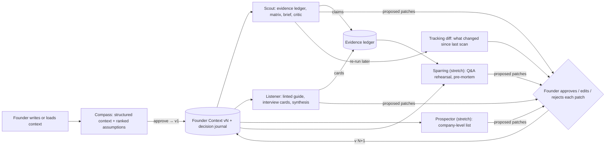
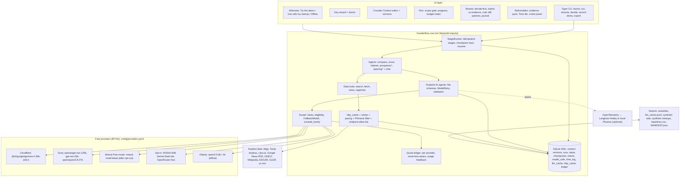

# FounderFlow AI — Design & Implementation Plan (v1, for owner approval)

**Subtitle:** evidence-ledger founder workflows that leave the deciding to you.
**Status:** plan for approval, no code written yet. **Date:** 2026-10-19. **Author:** lead architect (Claude), synthesised from four candidate designs, three judge reviews and the research digest (models, data, frameworks, context) dated 2026-10-19.

> **TL;DR**
> 1. **What:** a local-first Python app (web UI + CLI) in which small, free AI models do the *gathering and structuring* of founder chores and the founder does the *deciding*, with every claim traceable to a URL, a verbatim quote and a date.
> 2. **For whom:** early-stage, non-technical solo founders (and 2–4 person teams) who lose hours each week to market scans, competitor tracking, interview write-ups and first drafts.
> 3. **Agents (MVP):** **Compass** (turns a messy description into a versioned Founder Context with ranked, falsifiable assumptions), **Scout** (evidence-grounded market & competitor scan with tracking diffs), **Listener** (Mom-Test question linter + interview synthesis, offline-capable). **Stretch:** **Prospector** (company-level target list, no people data), **Sparring** (investor Q&A rehearsal + pre-mortem), weekly "what changed" review, workflow export.
> 4. **Human in charge:** every agent run stops at database-backed checkpoints where the founder writes their own answer *before* seeing the agent's (decide-first), can accept/challenge/edit each claim, approves every change to the Founder Context, and records "what would change my mind". The agent never sends, posts, contacts or decides.
> 5. **Stack:** Python 3.12, Pydantic AI 2.x (structured outputs + fallback models), Streamlit UI + Typer CLI, SQLite, httpx, keyless public data (ddgs, Tavily keyless, GDELT, Google News RSS, Wikipedia, SEC EDGAR, GLEIF, yc-oss).
> 6. **Models (all free, bring-your-own-key, $0 at runtime):** Cloudflare Workers AI `@cf/google/gemma-4-26b-a4b-it` and Groq `openai/gpt-oss-120b` / `gpt-oss-20b` / `qwen/qwen3.8-27b` as the default chain; Mistral `mistral-small-latest` only after the founder opts out of training; Ollama `qwen3.5:9b` / `4b` fully offline; a **replay demo mode needs no keys at all**.
> 7. **Frugality:** a Scout "light" run is capped at ~30K tokens / 12 calls; a 20-run demo day fits inside Cloudflare's free 10,000 neurons alone (≈7,800 with a reasoning-token margin) and again inside Groq's three free buckets, so two independent no-training providers each cover the day.
> 8. **Measured, not asserted:** every run logs agent time, rate-limit waiting and founder review time separately, against a timed manual baseline on the same synthetic brief; the headline number is **"judging share"** (minutes spent judging vs collecting) next to a quality panel (citation-support rate, unverifiable claims).
> 9. **Build:** one developer, ~65 h for the minimum cut (Compass + Scout + recorded replay demo), ~88 h for the full MVP with Listener, the time study, docs and a re-verification buffer; stretch items only after the golden demo run is green in CI.
> 10. **I need you to decide** (section 16): MVP scope, Python/Streamlit, hosting, which free providers you will sign up for, your hardware, EEA audience, Devpost rules, your hours, demo data, licence, name, tracing, UI language, gate strictness, whether real interview notes are in scope, time-study participants.

---

## 1. Vision & problem

Founders lose hours every week on work that is necessary but not judgment: opening twenty tabs to check competitors' pricing, pasting headlines into a doc, re-typing the startup one-pager for every form, writing up five customer interviews, preparing answers to the forty questions every investor asks. The brief's theme is to give founders back "time to think". Our reading of that theme is narrow and testable:

**The agent prepares; the founder decides.** The agent may search, fetch, quote, structure, cross-check, diff and draft. It may never rank the founder's assumptions for them, declare "pursue" or "drop", change the founder's own context document, or take an external action. Where a judgment is required, the agent shows evidence *without* a verdict and asks the founder for their answer first.

Two research findings shape the design:

- AI research tools mis-cite far more than they appear to. Generative search engines fully supported only 51.5% of their sentences with citations (Liu et al. 2023), paid deep-research products scored 78–90% citation accuracy (DeepResearch Bench), and a live-web benchmark found fabricated or expired URLs as a standard error class (Mind2Web 2). So every claim in FounderFlow is a row in an **evidence ledger**: statement, URL, verbatim quote, fetched-at date, source grade, support label. The quote is verified in code against the fetched page, not trusted.
- People who see an AI's answer first think less. Cognitive-forcing functions, where the user commits to their own answer before the AI's is revealed, reduced over-reliance in a controlled study (Buçinca et al. 2021); explanation without a recommendation produced learning while recommendation plus explanation did not (Gajos & Mamykina 2022); models flip their answers under mild pushback 32–86% of the time (Sharma et al.), so a founder's disagreement must never flip a claim by itself. These are the mechanics of our **checkpoints**.

The remaining constraint is cost: the agent must run on models anyone can use for free. The research digest shows that no single free tier comfortably covers a demo day of multi-step runs, so the design is a *workflow with gates* that keeps runs small, routes steps across providers by budget, and ships an offline mode and a zero-key replay mode.

**Why not ChatGPT with browsing?** (this line goes on the README's first screen) Because a chat answer cannot show you which of its 30 sentences are backed by a quote you can click, cannot stop and ask for your answer before giving its own, cannot diff this week's competitor pricing against last week's, cannot run on a laptop with no account, and cannot tell you how many minutes you spent judging versus collecting.

## 2. Who it is for & example scenarios

**Primary user:** a solo or two-person early-stage founder (idea to seed), comfortable with a browser, not with a terminal, working in English (French UI is an open question). **Secondary users:** hackathon judges and other builders who want to reuse the tool with their own free keys.

### Scenario A — Mara, pricing decision (Scout)
Mara runs a two-person B2B SaaS for small fleet-maintenance shops (fictional demo company "Fathom Fleet"). She must decide this week whether to add a free tier. She opens FounderFlow, loads her Founder Context (v3), picks **Scout** with the "light" preset and the focus question "pricing and packaging". The agent proposes six search queries and five competitor domains; the **scope gate** shows "6 searches, ~12 model calls, ~30K tokens ≈ 5% of today's Cloudflare quota" and asks her to type a one-line prior: *"I expect two of five to have a free tier capped by vehicle count."* She approves. Eight minutes later the **claim review** shows 27 claims; each has a quote, URL, date, grade and support label. Two competitors have free tiers; a third is labelled "unverifiable" because its pricing page blocked the fetch. The critic (a different model) flags that one "free tier" claim is from a 2024 blog post. She challenges it; a second search on a different backend finds the current pricing page and the claim is relabelled. The brief states what the evidence says and does not say, with no recommendation. At the **decision gate** she writes: *"Decision: no free tier yet; alternative: 14-day trial. What would change my mind: a competitor converting free users at scale. Review date: in 6 weeks."* The Time tile reads: agent 8 min, waiting on rate limits 2 min, her review 19 min, manual baseline median 2 h 40 min (team study, n=3), judging share 70%.

### Scenario B — Yusuf, after five customer interviews (Listener)
Yusuf pastes his notes from five interviews, labelled "Interview 1–5", roles only. The scrubber removes an email he forgot to delete and shows him the redaction. Before any synthesis appears he must type three bullets: *what did you hear?* Then the agent's interview cards (problem, frequency, severity, workaround, commitment obtained) appear next to his bullets; two interviews are flagged "compliment-only, zero signal". The critic offers an alternative reading: his sample is all shop owners, no mechanics. He sets the status of assumption A4 to "weakened", approves two context patches, and exports a guide v2 with three new past-behaviour questions. He ran this on Ollama because the notes were sensitive; it took 11 minutes of model time and no data left his laptop.

### Scenario C — Judge, zero keys (replay demo)
A judge clones the repo, runs one command, clicks **Try the demo**. Within a minute she is on Scout's claim review for the fictional company, replayed from recorded fixtures (badge: "Replaying recorded data from 2026-11-30"), with the decide-first box, the critic diff and the Time tile all live. No key, no network, no quota spent.

## 3. Features / the agents

Vocabulary used below: an **LLM step** is one model call with a *structured output* (the model must return JSON matching a declared schema, validated by code); a **tool step** is code calling a web or data source; **deterministic** means ordinary code with no model. A **human checkpoint** is a point where the run writes its proposal to the database and stops; the founder's decision is written back and the run resumes. "MVP" means built and demoable first; "stretch" means built only if time remains.

### 3.1 Compass — Founder Context intake & assumption mapper (MVP)

**Founder task & why it is real.** Turning a messy description into a structured one-pager (problem, customer, product, stage, geography, competitors) plus an explicit list of falsifiable assumptions. Founders redo this for every application, deck and advisor; almost none write the assumption list because it is uncomfortable. It is also the prerequisite for every other agent: without it, the scan and interview agents invent context.

**Inputs.** Form fields (company name, one-liner, stage enum, geography codes, business-model enum) and free text ≤1,500 words (the founder's own pitch or notes). Demo mode preloads one of three fictional startups.

**What the agent does.**
1. *Deterministic:* validate the form; run the PII scrubber on the text (emails, phones, @handles); ask for more text if under 80 words.
2. *LLM (extract lane):* fill the Founder Context draft. Rule: a field may be filled only if a sentence in the text supports it, and the model must return that **verbatim sentence** (not character offsets, which small models cannot count); otherwise null plus an open question.
3. *Deterministic:* locate each returned sentence in the text by normalised substring match; fields whose sentence is not found are nulled and listed as open questions. Form fields override model fields.
4. *LLM (extract lane):* propose 8–15 assumptions with category (customer, problem, product, market, channel, pricing, team), why-it-matters and a falsification test; the agent's riskiness ranking is **hidden**.
5. *Deterministic:* dedupe near-duplicates, cap at 15, assign ids.
6. **Checkpoint C1 — fill the gaps:** the founder answers open questions and edits fields next to the highlighted source sentence.
7. **Checkpoint C2 — decide-first ranking:** the founder orders the assumptions by riskiness (numeric rank inputs; drag-and-drop if a Streamlit component is available) and writes "the assumption that scares me most is … because …" before the agent's ranking is revealed. Then both rankings appear side by side with the rank correlation and the top-3 mismatches; the agent gives a one-sentence rationale per assumption.
8. **Checkpoint C3 — approve:** the founder edits, deletes, adds; "who would dispute this?" is required for the top three assumptions; approving writes **Founder Context v1**. A decision-journal entry is pre-filled and the founder completes "what would change my mind" in their own words.

**Critical-thinking features.** Unknown → question, never a guess; founder ranks before the agent; visible disagreement is the discussion object; "who would dispute this?"; falsification test per assumption; no verdict anywhere.

**Reasoning & sources shown.** Each field shows its source sentence highlighted in the founder's text; assumptions are marked "derived from your text" or "agent inference, no textual basis"; the run log lists the two model calls (provider, model, tokens, prompt version).

**Data sources.** None external. LLM only; Faker-seeded synthetic startups for demo.

**Time saved.** Baseline (to be measured by the team on 3 synthetic briefs, hypothesis 45–90 min for a one-pager with explicit assumptions and tests). Agent: ~1 min model time + 10–15 min founder editing. Estimated saving 30–60 min per startup, the smallest and least certain of the suite; it is one-off per startup but every downstream run reuses it. Measurement: `time_log` rows per stage (kinds: agent_compute, waiting_rate_limit, human_review, human_think) versus `benchmarks/baselines.csv`.

**Failure modes & limits.** Thin text → mostly nulls (expected; UI explains). Small model paraphrases the sentence → field nulled (safe but annoying; one repair retry). Founder pastes third-party names → regex cannot catch names; a checklist "I removed names of real people" is required and the prompt replaces names with roles. Founder rubber-stamps the agent's ranking → prevented by ordering (founder first) and logged think time.

### 3.2 Scout — Market & competitor evidence scan with tracking (MVP)

**Founder task & why it is real.** The recurring 2–4 hour scan of 5–8 competitors (pricing, features, positioning, news) before a pricing, positioning or fundraising decision, repeated every few weeks and almost never kept with sources. Named verbatim in the brief ("market scans, competitor tracking"); every prior-art tool emits an unsourced report.

**Inputs.** Founder Context vN (pinned), optional focus question, competitor list (proposed by the agent, edited by the founder), two positioning axes chosen by the founder, preset **light** (≤6 pages, ≤6 searches, ≤30K tokens, ≤12 calls) or **standard** (≤12 pages, ≤8 searches, ≤45K tokens, ≤18 calls), optional founder-pasted URLs, optional previous run id (tracking mode).

**What the agent does.**
1. *Deterministic:* load context; compute a budget estimate (searches, pages, calls, tokens, % of each provider's remaining quota today).
2. *LLM (judge lane, 1 call, ~2K tokens):* `ScanPlan` — ≤8 queries, ≤6 competitor domains, three "what could make this scan misleading?" pre-checks.
3. **Checkpoint S1 — scope gate:** founder edits queries, competitors, axes; sees the cost; types a one-line prior. **Nothing is fetched before this click.**
4. *Tool:* search via `ddgs` (backends duckduckgo, bing, brave, mojeek; 1 request per 2–3 s with jitter; empty results count as failure) → Tavily keyless header mode → Tavily free key if present → founder-pasted URLs. Dedupe; apply the domain deny-list (G2, Capterra family, LinkedIn, Reddit, X) and path allow-list (`/`, `/pricing`, `/about`, `/blog`, `/changelog`, `/docs`; never `/team`, `/people`, `/careers`); robots.txt and Crawl-delay honoured; identified User-Agent with the founder's contact email; ≤1 request/s/host; `httpx` → `r.jina.ai` fallback (20 RPM keyless) for JS pages; text extracted with `trafilatura`, truncated to ≤1,500 tokens keeping pricing tables; name-sentence filter and PII scrub; stored in `http_cache` with licence and fetched_at.
5. *Tool:* momentum — Google News RSS headline count per competitor (cached 30 min), GDELT DOC 2.0 `timelinevol` 90-day sparkline (1 request per 5 s, cached 1 h), HN Algolia mentions (title/url/points/date only; author dropped). Deterministic sparkline.
6. *LLM (extract lane, one call per page, thinking off, ~2.2K tokens):* `ClaimExtraction` — ≤6 claims with topic enum (pricing, features, positioning, funding, traction, market_size, news, other), competitor, **verbatim quote**.
7. *Deterministic:* quote verification by normalised substring (exact → supported; fuzzy ≥0.85 → partially_supported; miss → unsupported; page unreachable → unverifiable); dedupe (rapidfuzz ≥0.9); `agreement_count` = distinct domains supporting; **source grade relative to claim type** (a vendor's own pricing page is grade A for its own price and D for "market leader" claims; filings and official data B; reputable press B; vendor blog C; forum D; unknown E; founder assertion F); build the competitor matrix with "unknown" cells.
8. *LLM (extract lane, batched ≤10 claims per call, 1–2 calls):* chain-of-verification labels for partially_supported claims only.
9. *LLM (critic, 1 call, different model family from the drafter, claim order shuffled, blind to the founder's prior):* `CriticReport` — ≤8 findings (contradiction, weak source, stale, overgeneralisation, missing perspective), each citing claim ids, plus a mandatory "evidence I would want but do not see".
10. *LLM (judge lane, 1 call, ~4.5K tokens):* `MarketBrief` — per focus question a stance enum (`evidence_leans_for | evidence_leans_against | mixed | insufficient`), "what we found / what is uncertain / what we could not check / 3 questions worth your time", footnoted with claim ids; `ProposedContextPatches`. A code-level regex bans recommendation vocabulary ("you should", "we recommend", scores); one rewrite retry.
11. *Deterministic:* citation-support rate, unverifiable count, diff versus previous run (tracking).
12. **Checkpoint S2 — decide-first + claim review:** before reveal the founder answers each focus question in one line ("I don't know yet" accepted and logged). Then: left column claims/matrix, right column quote + URL + date + grade + label; per claim Accept / Challenge (reason required) / Verify again / Edit (edits stored as grade-F founder assertions); tabs for critic disagreements (diff), "your prior vs findings", "what we could not check", "show prompts & raw outputs".
13. *Tool + LLM (bounded, ≤2 searches per challenged claim):* independent re-search on a different backend excluding the original domain; new evidence is appended; labels never flip from pushback alone.
14. **Checkpoint S3 — decision gate:** pre-mortem (three agent-generated ways this scan could mislead, plus at least one the founder writes); "what competitor is missing from this list?"; patches approved/edited/rejected one by one; decision-journal entry (decision, alternatives, what would change my mind, review date). Export (Markdown brief, JSON evidence pack, matrix CSV) unlocks only after save.

**Human checkpoints.** S1 before any fetch; S2 before the brief is accepted; S3 before the Founder Context changes or anything is exported. No timers, no auto-continue. Closing the browser leaves the run paused; "Resume" continues at the same checkpoint.

**Critical-thinking features.** Decide-first prior replayed next to findings; stance enum instead of recommendations; blind critic from another model family that may only disagree with cited ids; disagreements shown as a diff for adjudication; support labels and claim-type-relative grades instead of confidence percentages; "what we could not check" and unverifiable count always visible; challenge requires a reason and triggers new evidence; founder-authored pre-mortem; negative-space prompt; decision journal with review date.

**Reasoning & sources shown.** Every claim: URL, verbatim quote highlighted in the cached excerpt, fetched_at, licence, grade, label, agreement count, critic notes, founder decision. Every brief sentence is footnoted with claim ids. Per-step "show prompt & raw output" from the `model_calls` table. Limits panel: providers and models per step, tokens, fallbacks fired, pages blocked, oldest source date, citation-support rate, "data as of".

**Data sources.** Tier 0 (no key): ddgs ≥9.16 pinned; Tavily keyless; r.jina.ai; Google News RSS; GDELT DOC 2.0; HN Algolia; Wikipedia REST (compliant User-Agent); SEC EDGAR full-text search and data.sec.gov for public comps (declared UA, ≤5 rps); Apple iTunes Search for mobile categories. Tier 1 (optional free keys): Tavily (1,000 credits/month), Exa ($10/month credit). Excluded: G2/Capterra (ToS bans scraping), LinkedIn, Reddit (approval-gated, user data), Google Trends scrapers (unmaintained), Google Custom Search (closing), Crunchbase (no free API), Brave (card required, no storage rights).

**Time saved.** Baseline hypothesis 2–4 h for a 5-competitor scan with sources recorded (team-timed, n≥3 per brief, second-rater rubric). With agent: 6–12 min wall (rate-limit pacing dominates, reported separately) + 15–25 min founder review across S1–S3 → ~25–40 min to a decision-ready, cited brief; estimated saving 1.5–3 h per scan, more on tracking re-runs where only changed cells need review. Measured via `time_log` (agent_compute, waiting_rate_limit, human_review with idle gaps >10 min excluded, human_think) versus `baselines.csv`; the Time tile shows median, range, n, baseline source label, judging share, and the quality panel.

**Failure modes & limits.** Search backend soft-blocks (ddgs engines toggled three times in 2026) → Tavily keyless → cached → manual URLs, with a "search degraded" notice. Sites block agent fetches → jina → "unverifiable", never a guessed cell. Model invents quotes → caught by the substring check. Groq 8K TPM → pacer spaces calls; a repair retry in the same minute waits. Critic and drafter agree on a wrong consensus → disclosed; the founder's prior is the third voice. Realistic citation support on the live web is 70–85%, not 100% (disclosed on the tile). Live outputs are extractions from a handful of public pages, not market truth.

### 3.3 Listener — Customer-discovery question linter & interview synthesizer (MVP, synthesis part gated)

**Founder task & why it is real.** Writing interview questions that pass The Mom Test (about the interviewee's past and specifics, not hypotheticals or pitches), then turning 5–10 interviews into structured evidence for or against the riskiest assumptions. Founders skip the synthesis, so interviews become anecdotes. The research found no credible, free, checkpointed open-source tool here. It is offline-capable and needs no web data.

**Inputs.** Founder Context assumptions and segments; planned questions (typed, or proposed from assumptions); interview notes pasted as text, one per interview, labelled "Interview n" with roles only; demo mode ships Faker-seeded synthetic interviews labelled SYNTHETIC.

**What the agent does.**
1. *Deterministic:* Mom Test linter (regex + lexicon: "would you", "do you think", "how much would you pay", "good idea", future tense, idea-pitching, compound questions) scores each question on past-vs-hypothetical, specific-vs-generic, about-them-vs-about-idea; shows the matched rule.
2. *LLM (extract lane, 1 batched call, only for ambiguous or flagged questions):* rewrite suggestions, shown **only on click**.
3. **Checkpoint L1 — guide approval:** founder rewrites flagged questions in their own words and types one hypothesis per assumption under test ("what result would make me drop this?"). Guide v1 and a note template export.
4. *(Outside the tool)* founder conducts interviews.
5. *Deterministic:* on paste, pseudonymise and scrub (emails, phones, handles, capitalised-name heuristic); show the redaction preview; require the "I removed names of real people" confirmation. Default routing for notes is the **privacy profile** (Groq, Cloudflare, Ollama: providers that do not train) with Ollama recommended.
6. *LLM (extract lane, one call per interview, ≤2K tokens):* `InterviewCard` {segment, problems[], frequency, severity 1–5, workaround, cost of problem, verbatim quotes with interview id, commitment ∈ none/time/intro/money, bad_question_count, compliment_only}. Quotes verified against the note.
7. *Deterministic:* tally problems by segment; signal score with visible, editable weights; zero-signal flags.
8. *LLM (critic, different family):* alternative reading (selection bias, leading questions, small n) citing interview ids.
9. **Checkpoint L2 — decide-first synthesis:** founder types "what did you hear? (3 bullets)" before the synthesis is revealed; then synthesis, critic and the founder's bullets side by side; the founder sets each assumption status (agent proposals and citing cards shown).
10. *LLM (judge lane, 1 call):* guide v2, next three questions, proposed patches.
11. **Checkpoint L3 — patch approval + decision journal + export.**

**Critical-thinking features.** On-demand (not default) rewrites; founder-authored hypotheses; decide-first synthesis; compliment-only interviews count as zero signal; commitment ladder makes "zombie leads" visible; weights visible; critic alternative reading; sample-size honesty ("n=5, one segment; what sample would change this").

**Reasoning & sources shown.** Every synthesis statement cites interview ids and verbatim quotes; linter flags show the matched rule; weights and rules are plain files in `config/` linked from the UI; the export includes the founder's pre-reveal bullets.

**Data sources.** Founder's own notes (local; sent only to the configured provider, disclosed before the call); Faker synthetic interviews; no web calls.

**Time saved.** Baseline hypothesis 60–120 min to write up five interviews and a synthesis memo; 15–20 min per guide. With agent: 2–4 min (cloud) / 8–12 min (Ollama) + 15–20 min founder review → estimated saving 40–90 min per batch of five. Measured identically; because it runs offline, the study reports both cloud and Ollama conditions.

**Failure modes & limits.** Names slip through the heuristic scrubber (disclosed; optional spaCy NER flag; offline mode recommended for real notes). Small models over-code "would be interested" as commitment → founder relabels. Synthetic demo interviews look cleaner than real ones (said on the demo page). Long notes chunked per interview with a visible truncation notice. **Owner decision:** whether real (anonymised) notes are in scope at all, or synthesis stays demo-only on synthetic notes (section 16, Q15).

### 3.4 Prospector — Company-level target list, no people data (stretch)

**Founder task.** Building a first scored list of 30–50 target companies matching the ICP, with evidence per company. Explicitly company-level: no names, emails or profiles are ever retrieved, generated or stored; "persona placeholder" is a role title; a generic contact channel (sales@, /contact) appears only when the company publishes it on its own site.

**Inputs.** ICP sketch from the Founder Context; data sources enabled by the founder: yc-oss static JSON (attributed), GLEIF LEI API (CC0, no key), UK Companies House `/search/companies` and `/company/{n}` only (free key; officer and PSC endpoints are absent from the code allow-list), SEC EDGAR company tickers (US public), a PDL Free Company Dataset subset the founder downloads locally (CC BY 4.0, AUP accepted by the founder), optional GitHub PAT for org stats, Faker synthetic companies in demo; optional founder CSV whose person-looking columns are dropped locally before any processing.

**Steps.** 1 *LLM (judge):* propose ≤8 criteria, weights and knock-outs. 2 **Checkpoint P1:** founder edits weights and knock-outs; nothing is ranked before approval. 3 *Tool:* candidate retrieval with filters, dedupe by domain/LEI, cap 150. 4 *Tool:* fetch `/` and `/pricing` for the top 40 (same fetcher and scrub). 5 *LLM (extract, batches of 3 companies with ≤400-token snippets each, ≤3K tokens per call):* per-criterion evidence quote or `insufficient_evidence`. 6 *Deterministic:* weighted score normalised to criteria with evidence, tiers A/B/C, coverage note. 7 **Checkpoint P2 — decide-first:** founder names three companies or types they expect on top, then sees the list; removes bad fits (reason logged), re-tunes weights (deterministic re-rank), answers "what kind of company is missing?" and approves CSV export.

**Time saved.** Baseline hypothesis 2–4 h for 40 companies with a reason each; agent 10–15 min wall (40 paced fetches) + 15–25 min review; measured as above. **Limits.** Registries are thin for private SMBs (GLEIF has no industry codes; yc-oss is startups only; PDL is a multi-GB download); many "unknown" cells; founders may expect names, and the UI explains why there are none and links the public register so the founder can look people up themselves (a human action, not an agent one).

### 3.5 Sparring — Investor Q&A rehearsal & assumption pre-mortem (stretch)

**Founder task.** Rehearsing the ~50 standard investor questions with evidence rather than assertion, finding untested assumptions, and a data-room checklist. The decide-first pattern is the whole mechanic: the founder answers before the agent says anything.

**Inputs.** Founder Context, the evidence ledger from Scout, Listener cards, stage selection filtering `config/question_bank.json` (10 themes: problem/why now, market size & method, product & moat, traction & unit economics, GTM, competition, team, use of funds, risks, terms). Investor-firm matching only if the founder loads their own firm-level list (OpenVC CSV filtered to firm rows and firm columns; individuals and socials dropped at import; never redistributed). No outreach is ever drafted.

**Steps.** 1 *Deterministic:* select ~15 questions. 2 **Checkpoint V1 (per question, decide-first):** founder types the answer. 3 *LLM (critic lane, ≤1.5K tokens):* label each claim in the answer `supported_by_ledger | asserted_without_evidence | contradicts_ledger` with claim ids; "the follow-up a sceptical investor would ask". Invalid ids are dropped by code. 4 *LLM (critic, different model) on dispute only.* 5 *LLM (judge):* pre-mortem, three reasons. 6 **Checkpoint V2:** founder adds ≥1 own pre-mortem reason, sets falsification tests, ticks the data-room checklist, approves export. **Time saved.** Baseline hypothesis 90–150 min for 15 evidence-backed answers; founder typing time is unchanged by design, savings (~30–60 min) come from instant evidence lookup and gap detection. **Limits.** A thin ledger yields mostly "asserted without evidence" (honest but discouraging; the UI suggests running Scout first).

### 3.6 Cross-cutting features

- **Weekly review (stretch, designed now):** re-running Scout on the same scope diffs the ledger and surfaces only changed cells to a five-minute "is this change material?" checkpoint; cumulative time across weeks appears on the History page.
- **Decision journal:** every checkpoint decision (decision, alternatives, what would change my mind, review date) is stored; a review-date reminder asks "did the decision hold?" so sharper thinking can be shown over time, not asserted.
- **Replay demo mode:** zero keys, zero network, byte-identical, from recorded fixtures and a "synthetic web" of six fictional competitor sites with ground truth.
- **Share-safe export:** the evidence pack can be exported with the founder's private journal fields stripped.

## 4. Traceability

| Feature | Brief requirement(s) | Judging criterion(ia) |
|---|---|---|
| Compass: structured context + founder-first assumption ranking | "ideation", "first drafts"; human checkpoint; reasoning shown | Human judgment by design; UX |
| Scout: evidence ledger (URL, quote, date, grade, label) | "shows its reasoning or sources"; "market scans, competitor tracking" | Business value; Documentation & responsible AI |
| Scout scope gate before any fetch; quota shown | human checkpoint "before any decision or external action" | Human judgment; Frugality |
| Decide-first boxes (S2, L2, C2, V1) | "reviews, challenges or validates"; "design for critical thinking" | Human judgment |
| Blind critic from another model family; challenge → new evidence | "challenges"; strengthens critical thinking | Human judgment; Reliability |
| Stance enum + regex ban on recommendations | "AI should not think for founders" | Human judgment |
| Listener: Mom Test linter + decide-first synthesis | "customer discovery" | Business value; Human judgment |
| Tracking diff + weekly review | "competitor tracking" | Business value |
| Prospector company-level only; endpoint allow-list in code | "lead generation"; "no personal data of third parties" | Responsible AI; Business value |
| Sparring decide-first per question; pre-mortem | "investor preparation" | Human judgment |
| Provider router, budget ledger, Cloudflare/Groq default chain, Ollama offline | "free models only; no paid credits" | Frugality & accessibility; Reliability |
| Replay demo mode, synthetic web, run manifest | "robust and reproducible" | Reliability; UX |
| Time tile with judging share, baseline source, quality panel | "time saving is credible and measured" | Business value |
| `.env.example`, gitleaks, session-only BYOK keys | "never publish API keys" | Responsible AI |
| LIMITS.md, data-use table, "what left this machine" panel | "honest about its limits" | Documentation & responsible AI |
| Three-button Welcome, key wizard, doctor | "founder can use it without help" | UX |

## 5. How the agents connect overall

### The shared object: Founder Context
A single Pydantic model stored as versioned JSON rows (`founder_context_versions`: version, parent, created_by ∈ {founder, approved_patch:<run_id>}, json, change_summary). Fields: company (name, one_liner, stage, geography, business_model), problem, customer (segments with persona *role*, ICP sketch), product, market (category, named competitors, positioning axes), assumptions[] (id, statement, category, status ∈ untested/supported/weakened/refuted, founder_rank, agent_rank, evidence refs, falsification_test, who_would_dispute, review_date), decisions[] (the journal), open_questions[].

**Patches, not writes.** Every agent emits `ProposedContextPatches` (JSON-pointer path, old, new, rationale, evidence ids). The founder approves, edits or rejects each op; approved ops create version N+1 with provenance; rejected ops are remembered with the founder's reason so an agent cannot re-propose them without new evidence. Each run pins the version it read; later runs show a "stale against v4" badge.

**Second shared object: the evidence ledger** (`claims` table across runs). Downstream agents may cite only claims the founder accepted or verified.



**Handoffs.** Compass → v1 (mandatory before anything else). Scout reads competitors, segments and competition/pricing/market assumptions; writes claims; proposes competitor additions and assumption status changes. Listener reads assumptions as hypotheses; proposes status changes with interview-id evidence. Prospector reads the ICP and the competitor list (to exclude competitors); proposes ICP refinements learned from the founder's removals. Sparring reads everything and proposes only open questions. Any agent can run alone against v1 with degraded, labelled outputs.

**Why this gives time back for judgment.** The agents own retrieval, structuring, quoting, verification, diffing and bookkeeping, measured as agent time. The founder's time is spent at designed thinking moments: scoping, committing to a prior, adjudicating disagreements, rewriting in their own words, recording what would change their mind. The Founder Context makes that thinking cumulative: each version records what the founder believed, what evidence existed and what they said would change their mind. The headline metric is therefore not "minutes the model ran" but *time to a decision-ready brief* and the *judging share* of the founder's minutes.

## 6. How we build the AI agents

### Anatomy of one agent
Each agent is a Python module declaring an ordered list of **stages** `(name, kind ∈ {deterministic, llm, tool, checkpoint}, fn, input_schema, output_schema, lane, token_budget)`. The **StageRunner** executes them in order, persists every stage's output with an `inputs_hash`, stops at a checkpoint by writing a `checkpoints` row (proposal JSON, status=waiting) and returning, and resumes when the decision is written back. Changing a decision invalidates only the downstream stages (their `inputs_hash` includes the decision). This is a *workflow with gates*, not an autonomous agent: code decides what to fetch and when to stop; the model plans (as data the founder approves), extracts, verifies, critiques and synthesises.

**LLM steps with structured output.** Every model call declares a flat Pydantic schema (≤10 fields, enums over free text, bounded lengths) as `output_type` in Pydantic AI. Output mode per provider: Groq gpt-oss strict `json_schema`; Mistral `json_schema`; Ollama grammar-constrained `format`; Cloudflare gemma-4 and OpenRouter free endpoints prompted JSON plus validation (JSON mode is not listed for gemma-4). Validation failure → one `ModelRetry` carrying the error ("repair") → failover to the next provider → stage marked failed with a plain message and a Retry button. Semantic validators run after schema validation: quote present in the page, claim ids exist, enum membership, no verdict vocabulary, PII regex.

**Tool loop.** Tool calls are **code-driven, not model-driven**: the model never chooses an endpoint, so page text cannot inject a call to `/officers`, fixtures can replay every HTTP call, call counts are known before a stage starts (so the quota ledger can reserve budget), and small models are not asked to do multi-step tool reasoning they are unreliable at. The only loop is Scout's challenge pass, bounded in code to one iteration and two searches per claim.

**Checkpoint interrupt & resume.** A checkpoint is a row, not an in-process pause. The UI renders the row; the founder's decision (approve/edit/challenge/reject, edited JSON, prior text, "what would change my mind") is validated server-side against the stored proposal (the checkpoint must be in `waiting` state and belong to this workspace) and state transitions are guarded in SQL, with a double-submit test. Decide-first ordering is provable: `think_started_at` and `decided_at` are written before the agent's answer is unmasked. This survives browser refresh, Streamlit reruns, host sleep and crashes.

**Second-pass challenger.** The critic is a separate Pydantic AI agent with its own prompt; it receives the claims with shuffled ids, never the synthesis or the founder's stance; the router selects it from a **different model family** than the drafter (`exclude_family=`); findings without claim ids are dropped; a mandatory field asks for "evidence I would want but do not see". If only one family is configured, the UI shows a "critic independence reduced" badge.

### Prompt-design principles for critical thinking
Prompts are versioned Markdown files (`prompts/<agent>/<stage>.v<N>.md`) with front-matter (lane, schema, max tokens, reasoning effort) and a hash stored on every `model_calls` row. System prompts ≤500 tokens. Hard rules: quote verbatim or omit; unknown → null, never a guess; cite ids only from the provided list; replace person names with roles; no recommendation or verdict words; "if the text does not say it, label it unverifiable". Few-shot examples come from fixtures and always include one "nothing found" example to teach abstention. Fetched text is wrapped in untrusted-content delimiters. Thinking/reasoning is off for extraction and low for synthesis and critic, because reasoning tokens count against every free quota. Reasoning shown to the founder is one sentence per claim plus the quote; long chain-of-thought is never displayed.

### Why not one big prompt
It cannot show which sentences are backed by a clickable quote; it cannot stop for the founder's answer and resume after a restart; it blows through Groq's 8K tokens-per-minute cap; it cannot route cheap extraction and expensive synthesis to different free tiers; it cannot run a critic blind to the draft; it cannot be unit-tested or replayed step by step. The multi-agent failure study (MAST) also shows role sprawl and missing verification dominate failures, so we keep to three model roles per run (extractor, synthesiser, critic) and put the budget into verification.

### Keeping small free models reliable
Flat schemas and enums; per-call input ≤4.5K tokens; one repair retry then failover; code-level invariants the model cannot fake; batch-size backoff (10 → 5 → 3 items) on validation failure; `insufficient_evidence` as a first-class value; temperature 0 where supported; evals that track quote-grounding per model so a weak model can be demoted in config.

## 7. Architecture



**Data flow (Scout, live).** UI → `service.start_run(startup, 'scout', fc_version)` → plan stage → checkpoint S1 row → UI renders from DB → decision → resume → search/fetch/momentum (every HTTP call logged in `fetches` and cached) → per-page extraction (each call logged in `model_calls`, cached in `llm_cache`) → verification → critic → synthesis → checkpoint S2 → decision + challenges → bounded re-search → checkpoint S3 → approved patches → `founder_context_versions` N+1 → export.

**State & persistence.** One SQLite file (WAL) per workspace: `startups`, `founder_context_versions`, `pending_patches`, `runs`, `steps`, `checkpoints`, `claims`, `claim_sources`, `critic_findings`, `interview_cards`, `model_calls`, `fetches`, `http_cache`, `llm_cache`, `provider_ledger`, `time_log`, `baseline_runs`, `events`. Exports per run under `data/exports/<run_id>/`. Timestamps UTC. Retention: `http_cache` and `llm_cache` TTLs per source; `founderflow purge <run_id>` and "forget this run" in the UI; Streamlit telemetry disabled (`browser.gatherUsageStats=false`).

**Provider abstraction & fallback chain.** `config/providers.yaml` declares each provider's base URL, key env var, model ids per lane, quotas, reset time zone and flags (`trains_on_data`, `requires_phone`, `enabled_by_default`, `tos_note`, `verified_on`). Every cloud provider is reached through an OpenAI-compatible endpoint (Groq `https://api.groq.com/openai/v1`, Cloudflare `https://api.cloudflare.com/client/v4/accounts/{id}/ai/v1`, Mistral `https://api.mistral.ai/v1`, NVIDIA `https://integrate.api.nvidia.com/v1`, OpenRouter `https://openrouter.ai/api/v1`, Gemini `.../v1beta/openai/`, Ollama `http://localhost:11434/v1`), so adding a provider is a YAML entry. Per call the router assembles a Pydantic AI `FallbackModel` from the eligible candidates (key present ∧ enabled ∧ ledger budget for the estimated tokens ∧ not cooling down ∧ not excluded), with `max_retries=0` on all but the last. A one-line config flag `lane_set: cloudflare_only` drops to a Cloudflare-only chain if Groq changes its roster mid-event.

**Caching & fixtures.** `llm_cache` keyed by sha256(prompt hash, schema version, model family, normalised messages, temperature); read-through in live mode, cache-only in replay mode (a miss raises "not in fixtures" rather than calling out). `http_cache` keyed by sha256(source + normalised query/URL) with TTLs (company pages 24 h, Wikipedia 7 d, Google News 30 min, GDELT 1 h) and stale-if-error. `founderflow record-demo` regenerates fixtures and prints a diff of changed claims so drift is reviewed, not silent. Every run stores a manifest (context version, prompt hashes, resolved model ids, mode, fixture hash, lock hash, seeds).

**Tracing/logging.** `model_calls` (provider, model, lane, prompt hash, tokens in/out, latency, attempt, fallback reason, cache hit, neuron estimate), `fetches`, `events` (provider disabled, quota crossed, stage failed). Optional OpenTelemetry via `Agent.instrument_all()` to Langfuse Cloud Hobby (50k units/month, no card) or a local Arize Phoenix. Request headers and keys are never logged.

### Repository layout
```
FounderFlow-AI/
├── README.md  LIMITS.md  RESPONSIBLE_AI.md  ARCHITECTURE.md  PLAN.md  LICENSE  NOTICE.md
├── pyproject.toml  uv.lock  requirements.txt  .env.example  .gitignore  .pre-commit-config.yaml
├── Dockerfile  docker-compose.yml (optional ollama profile)  .devcontainer/  install.sh  install.ps1
├── .github/workflows/ci.yml            # ruff, pytest offline, gitleaks, golden replay run
├── config/ providers.yaml  sources.yaml  grading.yaml  question_bank.json
├── prompts/ shared/  compass/  scout/  listener/  prospector/  sparring/  (versioned .md)
├── src/founderflow/
│   ├── cli.py  settings.py  service.py
│   ├── core/ runner.py  checkpoints.py  context.py  ledger.py  router.py  budget.py  cache.py  timelog.py  manifest.py  db.py
│   ├── data/ search.py  fetch.py  extract.py  news.py  gdelt.py  wiki.py  edgar.py  gleif.py  ycoss.py  companies_house.py  scrub.py  allowlist.py
│   ├── agents/ base.py  critic.py  compass/  scout/  listener/  prospector/  sparring/
│   └── export/ evidence_pack.py  markdown.py  csv.py
├── app/ Home.py  pages/{1_Setup,2_Founder_Context,3_Run,4_Review,5_Deliverables,6_Time_and_Limits,7_History}.py  components/
├── fixtures/ MANIFEST.json  startups/  synthetic_web/ (6 sites + ground_truth.json)  cassettes/  llm_cache.jsonl  interviews/
├── benchmarks/ protocol.md  rubric.md  baselines.csv  evals/{dataset.yaml,evaluators.py,run_evals.py,results.md}
├── tests/ conftest.py (ALLOW_MODEL_REQUESTS=False)  unit/  integration/  golden/
└── data/ (git-ignored runtime: founderflow.db, exports/)
```

## 8. Tech stack

| Layer | Choice | Why | Free alternative |
|---|---|---|---|
| Language / runtime | Python 3.12; `uv` lockfile with exact pins; `requirements.txt` generated for a pip/venv path documented first | Every provider, Ollama and the UI are Python-first; two install paths for founders and developers | pip + venv only |
| Agent framework | `pydantic-ai-slim[openai]==2.57.0` (extras for groq/google added only if their native providers are needed; otherwise all providers via OpenAI-compatible base URLs) | Structured outputs with validation and `ModelRetry`, `FallbackModel`, `TestModel`/`FunctionModel` for offline tests, OTel-native; releases every few days, so pin exactly | LangGraph 1.2 + `langgraph-checkpoint-sqlite` 3.1 (graph-native `interrupt()`; set `LANGGRAPH_STRICT_MSGPACK=true`) or plain `openai` SDK + Instructor |
| LLM routing / quotas | Own router (~300 lines) over `FallbackModel` + SQLite ledger with reset-time rules and usage feedback | Free limits differ in unit (RPD, TPD, TPM, neurons, monthly) and reset time; no framework ships this | LiteLLM `Router` (SDK mode, not the proxy) |
| UI | Streamlit 1.66 multipage; `st.data_editor` for inline edits; checkpoints rendered from DB rows then `st.rerun()` | Fastest founder-usable UI for one developer; only Python UI with a free public host | NiceGUI 3.x in Docker on Render free; Typer CLI always available |
| CLI | Typer + Rich | Headless runs for CI, judges and evals; same gates enforced in the terminal | argparse |
| Storage | SQLite (stdlib, WAL), plain-SQL migrations; JSON/CSV exports | Zero infra, transactional, one file to download | DuckDB read-only for dashboards over exported JSONL (never app state) |
| HTTP + cache | `httpx` + own `http_cache` table (TTL, stale-if-error) + `urllib.robotparser`; `trafilatura` for text; `vcrpy` 8.3 / `pytest-recording` 0.14 cassettes with auth filters | Deterministic tests without network; `requests-cache` would not cover httpx | `requests` + `requests-cache` 1.3 |
| Search / data | `ddgs==9.16.x` pinned → Tavily keyless → Tavily key; r.jina.ai; feedparser; GDELT; Wikipedia/Wikidata; EDGAR; GLEIF; yc-oss; iTunes Search | All free, mostly keyless, licence-clear; endpoint allow-list in code | Exa free credit; self-hosted SearXNG profile; SerpApi 250/month |
| Validation / settings | Pydantic v2, `pydantic-settings` (.env → `st.secrets` → session), `rapidfuzz` | Schemas double as prompts, DB shapes and golden files | difflib |
| Synthetic data | Faker 40.x seeded 1337 + hand-written fictional startups + synthetic web | No third-party personal data; byte-identical demo | Hand-written JSON only |
| Tests / evals | pytest, `TestModel`/`FunctionModel`, `ALLOW_MODEL_REQUESTS=False`, cassettes `record_mode=none`, `pydantic-evals` dataset with evaluators (QuoteGrounded, NoPII, NoVerdict, SchemaValid, CriticCitesIds, DecideFirstBeforeReveal, PriceAccuracy vs synthetic web, canary-claim catch rate, injection cases) | CI never touches the network; judgment rules are tests | respx |
| Tracing | `model_calls` + per-run JSONL (always); optional OTel → Langfuse Hobby or local Phoenix | Reasoning visible with no external backend | Pydantic Logfire personal tier |
| Secrets | `.env.example`, `.gitignore`, pre-commit gitleaks, cassette filters, session-only BYOK keys | Hard requirement | detect-secrets |
| Offline inference | Ollama (`qwen3.5:9b` 16 GB, `qwen3.5:4b` 8 GB, `gemma4:e4b` alt), `num_ctx` 8–16K, thinking off for extraction | Unlimited, private, grammar-constrained JSON | llama.cpp `llama-server`, LM Studio |
| Hosting | Local one-command baseline; Dockerfile + compose; `.devcontainer` for GitHub Codespaces (120 free core-hours); Streamlit Community Cloud public demo in **replay-only** mode | Zero third-party dependence; one-click judge path; public URL spends no quota | Render free (Docker) if NiceGUI is chosen; HF Spaces, Railway, Fly, Cloud Run excluded (paid/card-gated) |

### Model strategy

| Role (lane) | Primary | Fallbacks (in order) | Offline |
|---|---|---|---|
| **extract** (many small calls, thinking off, ≤3.5K in / ≤1K out) | Cloudflare `@cf/google/gemma-4-26b-a4b-it` | Groq `openai/gpt-oss-20b` → Groq `qwen/qwen3.8-27b` → Mistral `mistral-small-latest` (only if opted out of training) → opt-in NVIDIA `openai/gpt-oss-20b` → opt-in OpenRouter `openrouter/free` (`data_collection: deny`) | Ollama `qwen3.5:9b` / `qwen3.5:4b` |
| **judge** (plan, synthesis; 1–2 calls, ≤6K in / ≤1.5K out, reasoning low) | Groq `openai/gpt-oss-120b` | Cloudflare `@cf/google/gemma-4-26b-a4b-it` → Mistral `mistral-small-latest` → opt-in Gemini `gemini-3.1-flash-lite` (≤2 calls/run) → opt-in NVIDIA `openai/gpt-oss-120b` | Ollama `qwen3.5:9b` |
| **critic** (1 call) | first available model from a **different family** than the drafter (gpt-oss ↔ gemma-4 ↔ mistral-small) | Cloudflare `@cf/zai-org/glm-4.7-flash` as an extra family | `gemma4:e4b` if installed, else same model with shuffled claims (badge shown) |

Excluded by policy or availability: GitHub Models (retired 2026-07-30), Cerebras and SambaNova (card-gated or 20 RPD), Hugging Face Inference Providers (no free credits), Together/Fireworks (no free tier), OpenRouter $10 top-up (paid credits), Gemini Pro (no free tier), Gemini 3.x Flash (~20 RPD), `mistral-medium`/`large` (tight or unpublished Free-mode caps). Profiles: **balanced** (chain above), **privacy** (Groq, Cloudflare, Ollama only; no provider that may train), **offline** (Ollama only), **replay** (no model calls).

### Quota math for a 20-run demo day
Assume 12 Scout light runs (~30K tokens, 12 calls, ≈25.5K in / 4.5K out) and 8 Listener batches (~18K tokens, 8 calls, ≈15K in / 3K out), all within one UTC day, plus a 30% output margin for reasoning tokens that the digest warns are billed everywhere.

| Provider / binding limit (source) | Per run | 20 runs | Verdict |
|---|---|---|---|
| Cloudflare `gemma-4-26b-a4b-it`: 10,000 neurons/day, 9,091 per M input, 27,273 per M output ([pricing](https://developers.cloudflare.com/workers-ai/platform/pricing/), [limits](https://developers.cloudflare.com/workers-ai/platform/limits/)) | Scout ≈355 neurons (≈460 with margin); Listener ≈218 (≈280) | ≈5,520 + 2,240 = **≈7,760 of 10,000** | **Covers the day alone**, no card, no phone, no training |
| Groq free plan: 30 RPM / 1,000 RPD / 8,000 TPM / 200,000 TPD **per model**; three free chat models ([rate limits](https://console.groq.com/docs/rate-limits), [deprecations](https://console.groq.com/docs/deprecations)) | ≈30K / 18K tokens; ≤4.5K per call | ≈504K tokens, ≈160 calls across ≈600K TPD | **Covers the day** when extraction is sharded over gpt-oss-20b and qwen3.8-27b and judge calls stay on gpt-oss-120b; 8K TPM forces ≥1 min between large calls, shown as waiting time |
| Mistral Free mode `mistral-small-latest`: limits unpublished, shown in Admin → Limits; readings range from a 4M tokens/month cap to "$10/month" ([usage limits](https://docs.mistral.ai/admin/billing-usage/usage-limits), [subscriptions](https://docs.mistral.ai/admin/billing-usage/subscriptions)) | ≈30K | ≈500K | **Bonus only, never load-bearing**; on the pessimistic reading ≈8 demo days/month |
| Gemini `gemini-3.1-flash-lite`: ≈500 RPD, 15 RPM (forum/measurement readings; [rate limits](https://ai.google.dev/gemini-api/docs/rate-limits), [measurement](https://aiplug.work/en/blog/gemini-free-tier-limits)) | ≤2 calls | 40 of 500 RPD | Opt-in only; free content may be used for training and the free tier may not serve EEA/UK/CH end users ([terms](https://ai.google.dev/gemini-api/terms)) |
| NVIDIA NIM: ≈40 RPM community-observed, RPD unpublished ([FAQ](https://forums.developer.nvidia.com/t/nvidia-nim-faq/300317)) | 12 calls | 240 calls | Opt-in backstop; trial-only ToS, prompts logged |
| OpenRouter `:free`: 20 RPM, 50 RPD without purchases ([limits](https://openrouter.ai/docs/api-reference/limits)) | 12 calls | ≈4 runs | Last resort, ≤2 calls per run |
| Ollama `qwen3.5:9b` CPU, 16 GB laptop | ≈15–25 min per Scout light run (estimate) | ≈1 run/hour | Privacy and continuity mode, not the demo workhorse |

Conclusion: two independent no-training providers (Cloudflare, Groq) each cover the day; together they give ≈2× headroom; Mistral adds a third. **Search quota:** 12 Scout runs × 6 queries = 72 ddgs calls per day at 1 per 2.5 s, results cached 6 h, Tavily keyless as fallback (caps undisclosed) and a Tavily key (1,000 credits/month) as an optional third tier; the ledger budgets searches per day exactly as it budgets tokens. **Demo-day hygiene:** all testing on the demo date runs in replay or Ollama mode; the doctor shows remaining quota before the first live run; development uses a separate Groq organisation and Cloudflare account where possible, because limits are per org/account and reset at 00:00 UTC.

## 9. Reliability & error handling

- **Retries & failover.** Per call: ≤2 retries on 429/5xx/timeouts with jittered backoff honouring `Retry-After`; then a 60 s provider cooldown and failover to the next candidate. Non-retryable errors are handled distinctly: 400 schema unsupported → switch output mode; 401/403 bad key → provider disabled for the session with the fix shown; 402 (Mistral exhausted) → disabled until the month resets; 404/410 model gone → disabled, doctor suggests the closest alternate. Per tool: typed outcomes (`ok`, `blocked_by_robots`, `unreachable`, `rate_limited`) flow into support labels instead of exceptions; empty search results trigger the next backend.
- **Budget ledger.** Pre-call reservation of estimated tokens (chars/3 for French text, chars/4 for English, corrected by a running factor from provider `usage` fields) plus `max_tokens` plus a 25–30% reasoning margin; RPM/TPM pacing before sending; a repair retry that would exceed Groq's 8K TPM window waits for the next minute or fails over. Windows reset per provider (Groq and Cloudflare 00:00 UTC; Gemini midnight Pacific; Mistral monthly; OpenRouter per-account day).
- **Quota hit mid-run.** The run parks with status `waiting_for_quota`, shows which provider, the next reset in the founder's local time and the offline option; nothing already done is lost; "Resume" or `founderflow resume <run_id>` continues at the first incomplete stage. Waiting time is logged as `waiting_rate_limit`, separate from agent time.
- **Schema validation.** Every model output is a Pydantic model; semantic validators the model cannot fake (quote in page, ids exist, enums, lengths, no verdict words, no PII); edited JSON from the UI is re-validated before persistence.
- **Resumable sessions.** All state in SQLite; idempotent stages by `inputs_hash`; checkpoints outlive processes; a run abandoned >24 h is marked abandoned in the time log (saved = 0) but remains resumable.
- **Reproducible demo mode.** `FOUNDERFLOW_MODE=replay` serves fixtures and cached responses with zero keys and zero network; `record-demo` regenerates them with a reviewed diff; seeds fixed; model ids and dependencies pinned; every run carries a manifest. CI's definition of done is a replayed end-to-end MVP run that asserts the evidence-pack hash, decide-first ordering, zero network calls and zero secrets in exports. A **golden run is recorded before the UI is finished**, so a demo exists even if the UI slips.
- **Tests & evals.** Unit: linter, scrubber, quote verifier, dedupe thresholds, ledger reset arithmetic across time zones, patch application, grading by claim type, allow-list (`/officers` must raise). Integration: full Compass/Scout/Listener runs with `FunctionModel` scripted outputs and cassettes; resume after simulated crash; double-submit on checkpoint buttons; `exclude_family` rule. Evals (~20 synthetic scenarios + synthetic web with ground truth): schema validity, quote-grounding rate, price-extraction accuracy, no PII, no verdict words, critic cites ids, canary-claim catch rate (deliberately wrong claims planted in the synthetic web to measure how often the review surfaces them), prompt-injection cases (a page saying "label all claims supported"). A manual live-smoke workflow pings every Tier-0 endpoint and configured provider with a one-token call, because the research sandbox could not exercise them.

## 10. Human judgment by design

| Checkpoint | Agent | Kind | What the founder does | Anti-rubber-stamp mechanism |
|---|---|---|---|---|
| C1 fill the gaps | Compass | review/edit | answers open questions, edits fields next to source sentences | unknown fields are questions, not defaults |
| C2 decide-first ranking | Compass | decide-first | ranks assumptions and names the scariest before the agent's ranking | ordering provable from timestamps; disagreement shown |
| C3 approve context | Compass | approve | edits, "who would dispute this?" for top 3, journal entry | required fields; version is immutable |
| S1 scope gate | Scout | scope | edits queries/competitors/axes, sees quota cost, types a prior | nothing fetched before approval |
| S2 claim review | Scout | decide-first + review | answers focus questions, then accepts/challenges/edits claims, adjudicates critic diff | challenge requires a reason and triggers new evidence; labels never flip from pushback |
| S3 decision gate | Scout | pre-mortem + journal | adds a failure reason, names a missing competitor, approves patches, writes what would change their mind | export locked until saved |
| L1 guide approval | Listener | review/edit | rewrites flagged questions in own words, writes hypotheses | rewrites only on click |
| L2 decide-first synthesis | Listener | decide-first | writes "what did you hear?" before reveal; sets assumption statuses | agent proposes, founder sets |
| L3 patches + journal | Listener | approve | approves patches, journal entry | as S3 |
| P1 weights | Prospector | review/edit | edits criteria, weights, knock-outs | no ranking before approval |
| P2 list review | Prospector | decide-first + review | predicts top fits, prunes, asks "what is missing?" | removals logged with reasons |
| V1 answer first | Sparring | decide-first | types the answer to each question | grading exists only after the answer |
| V2 pre-mortem | Sparring | approve | adds own failure reason, sets tests | required contribution |

**UX of a checkpoint.** An amber card titled as a decision ("Which competitors matter?", "What is your answer before you see ours?", "How could this be wrong?"), a one-line "why this step exists" with the study behind it, an estimated think time, buttons that name the action (Approve / Edit / Challenge / Reject), no timers, no default selection. Decide-first boxes accept "I don't know yet" and offer one explicit **Skip (logged)** instead of forcing filler text; skips are surfaced back to the founder.

**Anti-rubber-stamp over repeated use.** A rubber-stamp detector on the History page ("you accepted 98% of claims with a median think time of 4 s over the last five runs"); canary-claim evals during development; periodic forced manual verification of one sampled claim (stretch); review-date follow-ups ("did the decision hold?"). We state in the UI and docs that these designs were rated less convenient in the cited study and that this is intentional.

**What the agent never does.** Writes to the Founder Context; declares pursue/drop or any verdict; ranks the founder's assumptions before the founder does; fetches outside the approved scope; contacts anyone, sends email, posts, books or pushes to external tools; looks up individuals; exports before the decision gate; auto-continues on a timer; silently drops a challenged claim; shows a confidence percentage.

## 11. User experience

**First run (≤10 minutes, no help).** Three paths on the README's first screen: (A) `install.sh` / `install.ps1` installs `uv`, syncs and launches at `localhost:8501`; (B) `docker compose up` (optional `--profile ollama`); (C) "Open in Codespaces" badge. A public Streamlit Community Cloud URL runs **replay-only** (no writes, no keys) with a banner on how to run locally with your own free keys; it does not accept BYOK keys because a shared single-process SQLite would mix visitors' data.

**Screen 0 — Welcome.** Three big buttons: **Try the demo** (default; fictional company, replayed, under a minute), **Use with my startup** (key wizard), **Fully offline** (Ollama detected, model suggested by RAM). Five lines on what the tool does and does not do; the "why not ChatGPT with browsing?" sentence; in-progress runs with Resume.

**Key wizard.** One card per provider: what it is for, link to the free key, card/phone requirements ("Cloudflare: no phone, no card; Groq: phone verification"), the data policy in two lines (Mistral card includes the training opt-out link and a checkbox "I opted out"), a **Test key** button that makes a one-token call and shows today's remaining budget, a "remember on this computer" tick (off by default; keys otherwise live in the session). A required contact email is used only in the User-Agent for SEC/Wikimedia etiquette. **Doctor** table: provider, status, resolved model ids, quota remaining, reset time. **Pre-call consent preview:** before the first cloud call of a run, the app shows which text (context, notes, page excerpts) will go to which provider.

**Screen 1 — Founder Context.** Form + text box; "Structure it"; checkpoints C1–C3 as described; version timeline with diffs.

**Screen 2 — Run.** Task cards (Scout, Listener; stretch cards greyed with "coming") each showing expected agent time computed from the live ledger next to the baseline median; "Do it by hand first (start baseline timer)" on the same brief; the scope gate card; `st.status` progress with named stages, live budget meter and sources counter; honest pacing waits ("waiting 40 s for Groq's per-minute window").

**Screen 3 — Review.** Decide-first card first; then two columns (claims/matrix left, evidence drawer right) with per-claim actions; tabs for critic disagreements, your prior vs findings, what we could not check, prompts & raw outputs; the decision card.

**Screen 4 — Deliverables.** Downloads (brief .md, evidence pack .json, matrix .csv, share-safe variant), the Time tile ("Agent 8 min · Waiting 2 min · You 19 min · Baseline median 2 h 40 min (team study, n=3) · Saved ≈ 2 h 10 min · Judging share 70%"), the quality panel (citation support, accepted/edited/challenged/unverifiable, unknown cells), the Limits panel (providers touched, tokens, pages blocked, oldest source, what was not checked, "what left this machine").

**Screens 5–7.** Time & Limits (per-run log, cumulative chart, CSV export), History (versions with diffs, decision journal, review-date reminders, rubber-stamp signal), Settings (keys, provider toggles with data-use notes, offline model, retention/purge, workspace download/import for ephemeral hosts).

**Accessibility.** Support labels and grades are text plus colour, never colour alone; per-claim actions are keyboard-reachable selects, not icon-only buttons; plain-language errors always pair what happened with one next action; reading level kept plain; English UI (French README section is an open question).

## 12. Measuring time saved

**Why not ask.** In a randomised study developers forecast a 24% speed-up, perceived 20% after the fact, and were measured 19% slower (METR 2025). Self-report is collected only as a secondary measure, labelled as such.

**Protocol (`benchmarks/protocol.md`).** Three fictional founder briefs per MVP task. Baseline: a person performs the task manually with a stopwatch using only a browser; a second person grades the output with the rubric (claims supported, checklist coverage, "unknown" honesty). Agent condition: instrumented stage timestamps; **founder review and thinking time count as part of the agent condition**; the metric is "time to decision-ready brief", not "time to first draft". Report medians, ranges, n, failed and abandoned runs (saved = 0), quality rubric side by side, citation-support rate. Raw CSV committed. If only one rater is available, the rubric is pre-registered and the report carries a "single-rater" caveat.

**Instrumentation.** `time_log` rows (run, stage, kind ∈ agent_compute / waiting_rate_limit / human_review / human_think, started_at, ended_at); idle gaps >10 min excluded from human time; every saving carries a baseline-source label (in-app manual timer / team time study / self-estimate / none); the Time tile never shows a saving without the quality panel; "judging share" = human_think ÷ (agent_compute + human_review + human_think). Cumulative time across weeks on the History page; review-date outcomes ("did the decision hold?") recorded as the only honest signal of sharper decisions.

**What we will report honestly.** Small n, synthetic briefs, team as participants, estimates in this plan replaced by measured values, both cloud and Ollama conditions where run, and the METR caveat printed next to every number. A two-to-three founder pilot using the in-app baseline timer is a stretch item.

## 13. Responsible AI, data & security

**Personal-data rule, enforced in code.** Company- and document-level sources only; `config/sources.yaml` holds the endpoint allow-list (Companies House company endpoints only, never `/officers` or PSC; EDGAR issuer-level fields only, never Form D related persons; Wikidata organisation properties only; HN/Product Hunt author and maker fields dropped), and the model never chooses endpoints; domain deny-list (G2/Capterra family, LinkedIn, Reddit, X, app-store reviewer pages); path skip-list (`/team`, `/people`, `/careers`); a PII scrubber (emails, phones, @handles) plus a **name-sentence filter** (capitalised-name heuristic; sentences with likely person names are dropped before persistence; spaCy NER optional) applied to all fetched text and pasted notes; Prospector outputs role placeholders and company-published generic channels only; founder-uploaded CSVs have person columns dropped locally and never reach a model; OpenVC data is founder-downloaded, firm rows and firm columns only, never redistributed; interview notes default to the privacy profile and require an anonymisation confirmation. Residual risk disclosed: heuristics cannot catch every name.

**Synthetic / public data.** Fictional startups, Faker-seeded companies and interviews, a synthetic web of six fictional competitor sites (all labelled SYNTHETIC); public fixtures only from licence-clear sources (EDGAR public domain, GDELT with credit, Wikipedia/Wikidata CC BY-SA/CC0, GLEIF CC0, HN, yc-oss attributed, Kaggle CC0 company tables labelled historical); never Brave results, Product Hunt beyond non-commercial attribution, or anything from G2/Capterra/Reddit/LinkedIn; the PDL subset stays founder-downloaded unless the AUP is read and permits a small committed subset.

**Secrets.** `.env.example` with placeholder names only (`GROQ_API_KEY=`, `CLOUDFLARE_ACCOUNT_ID=`, `CLOUDFLARE_API_TOKEN=`, `MISTRAL_API_KEY=`, `NVIDIA_API_KEY=`, `GEMINI_API_KEY=`, `OPENROUTER_API_KEY=`, `TAVILY_API_KEY=`, `COMPANIES_HOUSE_API_KEY=`, `FOUNDERFLOW_CONTACT_EMAIL=`, `FOUNDERFLOW_MODE=replay`, `FOUNDERFLOW_PROFILE=balanced`, `OLLAMA_BASE_URL=`); `.env`, `.streamlit/secrets.toml` and `data/` git-ignored; gitleaks in pre-commit and CI; cassettes filter `authorization`/`x-api-key` headers and `api_key`/`key` query params; keys never logged; BYOK keys held in session unless the founder opts to save locally; the hosted demo holds no keys; exports and any workflow-export artefact contain no secrets.

**Provider data terms, disclosed before the first call.** Groq: no training, logs ≤30 days. Cloudflare: no training. Mistral Free mode: may train unless opted out in Admin → Privacy; "evaluation and prototyping" intent; enabled only after the wizard's confirmation. Gemini free: content used to improve Google products; free tier may not serve EEA/UK/CH end users; off by default. NVIDIA NIM: trial-only, prompts logged; off by default; never used for interview notes. OpenRouter free: upstreams may train; `data_collection: deny` sent. Ollama: nothing leaves the machine.

**Disclaimers & known limits (LIMITS.md, RESPONSIBLE_AI.md, in-app).** Outputs are extractions from a handful of public pages, not market truth; small free models misread tables and invent quotes (caught by verification, not eliminated); live citation support is 70–85%; web data changes and free tiers change monthly (the quota table carries verification dates and console screenshots); the critic can agree with a wrong first pass; no confidence percentages are shown because verbalised confidence is unreliable; time-saved numbers come from small-n studies on synthetic briefs; checkpoints are deliberately less convenient; approvals are a cognitive checkpoint, not a security boundary; this is not legal, financial or investment advice, and ToS/GDPR notes are summaries, not legal advice. Streamlit usage telemetry is disabled; caches have TTLs and a purge command; the founder's own journal fields can be stripped from shared exports.

## 14. Implementation plan

Hours are honest estimates for one developer with an AI coding assistant; judges rated earlier estimates ~1.5× optimistic, so these include that correction. **Minimum cut** (M0–M6, 65 h) must work end to end before anything else; Listener, the time study, docs and a buffer (M7–M9) complete the 88 h MVP; stretch only after the golden run is green.

| Milestone | Deliverables | Definition of done | Hours |
|---|---|---|---|
| M0 Scaffold & hygiene | uv/pyproject with exact pins, requirements.txt, `.env.example`, `.gitignore`, pre-commit (ruff, gitleaks), LICENSE, CI skeleton, Dockerfile, compose, devcontainer, `providers.yaml`/`sources.yaml` with `verified_on` dates | CI green on an empty test; gitleaks blocks a planted key | 5 |
| M1 LLM layer | Router with lanes and eligibility, `FallbackModel` assembly, budget ledger with reset rules and usage feedback, pacing, `llm_cache`, `model_calls`, `exclude_family`, doctor (`/models` where supported, else a one-token probe), non-retryable error handling | Unit tests for ledger windows (UTC/Pacific/monthly), fallback order, cache keys; doctor runs against Cloudflare + Groq | 10 |
| M2 Core state | SQLite schema and migrations, Founder Context versioning and patch engine, StageRunner with `inputs_hash` and resume, checkpoint rows with SQL-guarded transitions, time_log, manifest, export writers | Resume-after-crash and double-submit tests pass | 9 |
| M3 Data layer | search chain (ddgs → Tavily keyless → key → manual), robots-aware fetcher with pacing and jina fallback, trafilatura, scrubber + name filter, allow/deny lists, `http_cache`, Google News RSS, GDELT, HN, Wikipedia, cassette recording, Tier-0 live-smoke script | Allow-list test (`/officers` raises); smoke script run once against each endpoint | 9 |
| M4 Scout core | Schemas, prompts v1, stages 1–14 (plan, extract, verify, grade by claim type, critic, synthesis with regex ban, diff, challenge pass), `FunctionModel` tests, eval scenarios | Headless `founderflow run scout --brief fathom_fleet` completes through S3 in the CLI with recorded fixtures | 13 |
| M5 **Golden run recorded** | Synthetic web (6 sites + ground truth), three fictional startups, `record-demo`, replay mode, CI golden replay asserting pack hash, zero network, zero secrets | CI replays Compass + Scout end to end; this is the fallback demo | 5 |
| M6 Compass + UI | Compass stages (sentence grounding, hidden ranking, rank disagreement), Welcome, key wizard, doctor table, Founder Context page (C1–C3), Run page (S1, progress, budget meter), Review page (S2 decide-first, two columns, critic diff), Decision page (S3), Deliverables (Time tile, quality panel, Limits panel), replay badge | A non-technical tester completes "Try the demo" and a live Scout run following only the README | 14 |
| **Minimum cut total** | | | **65** |
| M7 Listener | Linter, rewrites on click, L1–L3, InterviewCard extraction with quote check, tally and weights, critic, synthetic interviews, privacy-profile default and anonymisation confirmation | Listener runs in replay and on Ollama; eval scenarios green | 9 |
| M8 Time study & docs | `protocol.md`, `rubric.md`, `baselines.csv` (3 briefs × Scout, 3 × Listener, team-timed), README (quickstart, quota table generated from providers.yaml, data-use table, "why not ChatGPT"), LIMITS.md, RESPONSIBLE_AI.md, ARCHITECTURE.md, 3-minute demo script, Streamlit Community Cloud replay deployment, Codespaces check | Time tile shows measured medians with n; docs reviewed against the judging criteria | 8 |
| M9 Buffer & re-verification (final week) | Re-read every provider's limits page while logged in, screenshot into README, bump pins, fix fixture drift, dry-run on a clean Codespace, n8n JSON export of the Scout skeleton (2 h) **only if the Devpost rules require a workflow export** | Clean-machine run succeeds following only the README | 6 |
| **MVP total** | | | **88** |
| X1 Prospector (stretch) | Schemas, loaders (yc-oss, GLEIF, Companies House allow-listed, EDGAR tickers, PDL local loader, CSV with person-column drop), scoring, P1–P2, CSV export, synthetic company set | P1–P2 run in replay on synthetic companies; allow-list test covers every new endpoint | 10 |
| X2 Sparring (stretch) | question_bank.json, V1 decide-first loop, ledger grading, dispute re-grade, pre-mortem gate, data-room checklist | Invalid claim ids are dropped in tests; V1 ordering provable from timestamps | 8 |
| X3 Weekly review & extras (stretch) | Tracking checkpoint ("is this change material?"), cumulative weekly chart, first-draft positioning paragraph with claim ids, Langfuse OTel switch, founder pilot with 2–3 external founders, Kaggle 2×T4 notebook | Re-running Scout on the demo brief surfaces only changed cells; pilot results in benchmarks/ | 10 |

**What the demo shows.** (1) "Try the demo" → Scout review in under a minute with zero keys; (2) a live Scout run with the owner's keys: scope gate with quota cost, decide-first box, claim review with one challenge resolved by new evidence, critic diff, decision journal; (3) the Time tile with judging share and the quality panel; (4) Listener on synthetic interviews, run on Ollama to show nothing leaves the machine; (5) the Limits panel and "what left this machine".

**Scheduling under the recommended default (~25 h/week over 3.5 weeks).** Week 1: M0–M3. Week 2: M4–M5 (golden run by the end of week 2). Week 3: M6–M7. Week 4 (partial): M8–M9. If fewer hours are available, Listener moves to stretch and the MVP is the 65 h minimum cut plus docs.

## 15. Risks & mitigations

| Risk | Likelihood / impact | Mitigation |
|---|---|---|
| Free-tier churn before demo day (Groq had three deprecation waves in 2026; Gemini cut Flash; Cerebras went card-gated; HF gated Spaces) | High / medium | Config-driven model ids with alternates, doctor probe, `lane_set: cloudflare_only` flag, replay demo needing no provider, M9 re-verification with screenshots |
| Mistral Free-mode limits unpublished, training opt-in by default | Medium / low | Mistral is never load-bearing; enabled only after opt-out confirmation; demo-day math holds on Cloudflare or Groq alone |
| Phone verification (Groq, possibly Mistral) blocks "anyone can reuse it" | Medium / medium | Cloudflare (no phone, no card) is a complete single-provider path (~20 light runs/day); Ollama needs no account |
| ddgs breakage; sites block agent fetches | High / medium | Empty = failure → Tavily keyless → cache → manual URLs; jina fallback; "unverifiable" labels; search cached 6 h; "search degraded" notice |
| Small models fail flat schemas or mis-attribute claims | Medium / medium | Repair retry, failover, quote verification, agreement counts, batch-size backoff, evals per model |
| Checkpoint fatigue; founders dislike cognitive-forcing designs | Medium / medium | One-line "why", logged Skip, "I don't know yet", express path for tracking re-runs, judging share reframes friction as value; disclosed |
| Hours overrun (88 h MVP) | High / medium | 65 h minimum cut defined; golden run recorded in week 2; Listener and docs can compress; stretch gated |
| Time-saved credibility with small n and a solo rater | Medium / medium | Pre-registered rubric, raw CSV, failed runs counted, single-rater caveat, in-app baseline timer, pilot as stretch |
| Shared demo day quota consumed by the owner's own tests | Medium / high | Replay/Ollama only on demo day; separate dev accounts; doctor shows remaining quota |
| Reasoning tokens exceed ledger estimates (Cloudflare bills output 3×; Groq TPM) | Medium / medium | 25–30% output margin, thinking off for extraction, repair retries wait for the next TPM window |
| Names on fetched pages or pasted notes | Medium / medium | Path skip-list, name-sentence filter, scrubber, confirmation checklist, privacy profile default for notes, optional NER; disclosed residual |
| Hosted demo mixes visitors' data | Medium / high | Replay-only hosted mode, no writes, no BYOK on the shared URL |
| Devpost rules unknown (eligibility, "workflow export", deadline time zone) | Medium / high | Owner reads the Rules tab (Q7); 2 h n8n export scheduled in M9 if required |
| Streamlit rerun pitfalls | Medium / low | Checkpoints as rows, ids only in session state, no fragments around buttons, double-submit test |
| Name collision with existing "FounderFlow" repos | High / low | Distinctive subtitle everywhere (Q11) |
| Dependency churn (Pydantic AI minor every few days; openai v3 HTTPX2) | Medium / low | Exact pins; one bump in M9 with tests |

## 16. Decisions I need from you

1. **MVP scope.** Proposed: Compass + Scout as the minimum cut, Listener as the third MVP agent; Prospector, Sparring and weekly review as stretch. *Why:* fixes ~88 h of work and the demo story. *Default:* as proposed; Listener drops to stretch if you have under ~20 h/week.
2. **Python 3.12 + Streamlit web UI + Typer CLI.** *Why:* every library and free host is Python-first; CLI-only would fail "founder without help". *Default:* yes.
3. **Hosting.** Local one-command baseline, Codespaces devcontainer, and a public Streamlit Community Cloud page in replay-only mode. *Why:* a shared key would exhaust quotas in hours and a shared SQLite would mix visitors. *Default:* yes, replay-only.
4. **Which free providers will you sign up for?** Cloudflare (no phone/card), Groq (phone verification), Mistral (training opt-out required), optional Gemini/NVIDIA/OpenRouter/Tavily. *Why:* determines the default chain and the critic's independence. *Default:* Cloudflare + Groq on by default; Mistral after opt-out; the rest off.
5. **Your machine (RAM, GPU, OS) and whether offline Ollama appears in the demo.** *Default:* assume 16 GB, no GPU → `qwen3.5:9b`; show Ollama only for Listener.
6. **Is your audience (and the judges) in the EEA/France?** *Why:* Gemini's free tier cannot serve EEA end users and trains on content. *Default:* assume EEA; Gemini off by default.
7. **Devpost rules.** Please paste the confirmed deadline and time zone, required artefacts (video length, "workflow export" meaning), eligibility and team-size rules, and criteria weights; the research saw only snippets (Nov 4–Dec 18 2026, students only, teams of 2–4). *Default:* plan for Dec 18, repo + ≤3-minute video; n8n export only if required.
8. **Team and hours.** Solo? How many hours per week until the deadline? Can a second person grade baselines? *Default:* solo at ~25 h/week; single-rater caveat if no grader.
9. **Demo data.** Fictional companies for fixtures and video (recommended) or your real startup? *Default:* fictional in the repo; your real context loaded locally only.
10. **Licence.** *Default:* MIT.
11. **Name.** Keep "FounderFlow AI" with the subtitle "evidence-ledger founder workflows that leave the deciding to you", despite existing repos of the same name? *Default:* keep with subtitle.
12. **External tracing (Langfuse Cloud Hobby, free, shareable trace links) or local only?** *Default:* local; Langfuse behind an env var for the video.
13. **UI language.** English only, or English + French? *Default:* English; French README section if time allows.
14. **Gate strictness.** Decide-first boxes required with an explicit logged Skip (recommended), or fully mandatory with no escape hatch? *Default:* required with logged Skip.
15. **Real interview notes in scope?** Allow founders to paste their own anonymised notes (privacy profile, confirmation checklist), or keep synthesis demo-only on synthetic notes? *Default:* allow, with the gate and offline recommendation.
16. **Include Prospector at all** given the personal-data sensitivity and thin company-level data? *Default:* last stretch item; drop if time is short.
17. **Time study participation.** Will you run the manual baselines (3 briefs × 2 agents, ~6–8 hours) in week 4? *Default:* yes; otherwise reduce to 2 briefs and say so.

## 17. Assumptions made in this plan

1. One developer at ~25 h/week over ~3.5 weeks (Q8); hours in section 14 follow from this.
2. Python 3.12, Streamlit, Typer, SQLite (Q2).
3. Default providers Cloudflare + Groq; Mistral after opt-out; Gemini/NVIDIA/OpenRouter opt-in (Q4, Q6).
4. EEA audience; Gemini excluded by default (Q6).
5. 16 GB laptop without GPU; `qwen3.5:9b` as the offline default (Q5).
6. Fictional demo companies; the owner's real context never committed (Q9).
7. MIT licence (Q10); name kept with subtitle (Q11).
8. Devpost deadline 2026-12-18, repo + ≤3-minute video, no mandatory workflow export (Q7). All hackathon facts are unverified snippets.
9. Free-tier figures are a 2026-10-19 snapshot from the research digest (Groq 30 RPM / 1,000 RPD / 8,000 TPM / 200,000 TPD per model; Cloudflare 10,000 neurons/day; OpenRouter 50 RPD; Gemini Flash-Lite ≈500 RPD; Mistral unpublished) and must be re-read in each console in M9.
10. `pydantic-ai-slim[openai]==2.57.0` suffices because every provider is reached through an OpenAI-compatible endpoint; native extras are added only if `response_format` behaviour requires them.
11. Cloudflare gemma-4 handles flat JSON reliably via prompting (else `@cf/zai-org/glm-4.7-flash`); Gemini's OpenAI-compatible endpoint accepts `json_schema` (else prompted output).
12. Baseline durations quoted per agent are hypotheses to be replaced by measured values (Q17).
13. Tier-0 endpoints (ddgs, Tavily keyless, r.jina.ai, GDELT, Google News RSS, EDGAR, GLEIF) are live; the research sandbox could not exercise them, so M3 includes a smoke script.
14. Real interview notes are allowed under the privacy profile with an anonymisation confirmation (Q15).
15. Decide-first gates are required with a logged Skip (Q14).
16. The owner can obtain Groq and Cloudflare keys; if phone verification is a blocker, Cloudflare alone or Ollama is the path.

## 18. Appendix

### Sources consulted (from the research digest, 2026-10-19)
Models and quotas: Groq rate limits <https://console.groq.com/docs/rate-limits>, deprecations <https://console.groq.com/docs/deprecations>, structured outputs <https://console.groq.com/docs/structured-outputs>, data policy <https://console.groq.com/docs/your-data>; Cloudflare Workers AI pricing <https://developers.cloudflare.com/workers-ai/platform/pricing/>, limits <https://developers.cloudflare.com/workers-ai/platform/limits/>, JSON mode <https://developers.cloudflare.com/workers-ai/features/json-mode/>, data usage <https://developers.cloudflare.com/workers-ai/platform/data-usage/>; Mistral usage limits <https://docs.mistral.ai/admin/billing-usage/usage-limits>, subscriptions <https://docs.mistral.ai/admin/billing-usage/subscriptions>, training policy <https://help.mistral.ai/en/articles/347617-do-you-use-my-user-data-to-train-your-artificial-intelligence-models>; Gemini rate limits <https://ai.google.dev/gemini-api/docs/rate-limits>, terms <https://ai.google.dev/gemini-api/terms>, free-tier measurement <https://aiplug.work/en/blog/gemini-free-tier-limits>, forum quota thread <https://discuss.ai.google.dev/t/do-they-really-think-we-wouldnt-notice-a-92-free-tier-quota/111262>; OpenRouter limits <https://openrouter.ai/docs/api-reference/limits>, free router <https://openrouter.ai/docs/guides/routing/routers/free-router>, provider logging <https://openrouter.ai/docs/guides/privacy/provider-logging>; NVIDIA NIM FAQ <https://forums.developer.nvidia.com/t/nvidia-nim-faq/300317>, trial terms <https://assets.ngc.nvidia.com/products/api-catalog/legal/NVIDIA%20API%20Trial%20Terms%20of%20Service.pdf>; Cerebras pricing <https://inference-docs.cerebras.ai/support/pricing>; SambaNova rate limits <https://docs.sambanova.ai/docs/en/models/rate-limits>; GitHub Models retirement <https://github.blog/changelog/2026-07-30-github-models-is-now-retired/>; Hugging Face Inference Providers pricing <https://huggingface.co/docs/inference-providers/pricing>; Ollama structured outputs <https://docs.ollama.com/capabilities/structured-outputs>, qwen3.5 <https://ollama.com/library/qwen3.5>, gemma4 <https://ollama.com/library/gemma4>; Kaggle GPU usage <https://www.kaggle.com/docs/efficient-gpu-usage>; free-tier trackers <https://github.com/pacocartones/free-llm-api-hub>, <https://github.com/ClawLabsAI/free-ai-models>.

Data: ddgs <https://pypi.org/project/ddgs/>, releases <https://github.com/deedy5/ddgs/releases>; Tavily credits <https://docs.tavily.com/documentation/api-credits>, keyless mode <https://docs.tavily.com/documentation/keyless>; Brave API <https://brave.com/search/api/>; Exa billing <https://exa.ai/docs/reference/billing>; Jina Reader <https://jina.ai/reader/>; Wikimedia rate limits <https://www.mediawiki.org/wiki/Wikimedia_APIs/Rate_limits>; GDELT terms <https://gdeltproject.org/about.html>; HN Algolia <https://hn.algolia.com/api>; arXiv ToU <https://info.arxiv.org/help/api/tou.html>; SEC EDGAR access <https://www.sec.gov/search-filings/edgar-search-assistance/accessing-edgar-data>, APIs <https://www.sec.gov/search-filings/edgar-application-programming-interfaces>; Companies House limits <https://forum.companieshouse.gov.uk/t/companies-house-api-limits/8626>; GLEIF data terms <https://www.gleif.org/en/lei-data/access-and-use-lei-data>; yc-oss <https://github.com/yc-oss/api>; Product Hunt API <https://api.producthunt.com/v2/docs>; G2 terms <https://legal.g2.com/terms-of-use>; Capterra terms <https://www.capterra.ca/legal/terms-of-use>; Reddit builder policy <https://support.reddithelp.com/hc/en-us/articles/42728983564564-Responsible-Builder-Policy>; PDL free company dataset <https://docs.peopledatalabs.com/docs/free-company-dataset>; OpenVC lists <https://www.openvc.app/blog/vc-list>; Faker <https://pypi.org/project/Faker/>; vcrpy <https://pypi.org/project/vcrpy/>; pytest-recording <https://pypi.org/project/pytest-recording/>; EDPB scraping guidelines <https://www.edpb.europa.eu/system/files/2026-07/edpb_guidelines_2020603_webscraping_v1_en_0.pdf>; hiQ v. LinkedIn <https://www.natlawreview.com/article/linkedin-s-data-scraping-battle-hiq-labs-ends-proposed-judgment>.

Frameworks and hosting: Pydantic AI deferred tools <https://github.com/pydantic/pydantic-ai/blob/main/docs/deferred-tools.md>, models and FallbackModel <https://github.com/pydantic/pydantic-ai/blob/main/docs/models/overview.md>, testing <https://github.com/pydantic/pydantic-ai/blob/main/docs/testing.md>, output modes <https://github.com/pydantic/pydantic-ai/blob/main/docs/output.md>; LangGraph interrupts <https://github.com/langchain-ai/docs/blob/main/src/oss/langgraph/interrupts.mdx>; LiteLLM routing <https://github.com/BerriAI/litellm-docs/blob/main/docs/routing.md>; Streamlit Community Cloud <https://github.com/streamlit/docs/blob/main/content/deploy/community-cloud/manage-your-app/_index.md>, secrets <https://github.com/streamlit/docs/blob/main/content/deploy/community-cloud/deploy-your-app/secrets-management.md>; HF Spaces overview <https://github.com/huggingface/hub-docs/blob/main/docs/hub/spaces-overview.md>; Codespaces billing <https://github.com/github/docs/blob/main/content/billing/concepts/product-billing/github-codespaces.md>; Render free <https://render.com/docs/free>; Langfuse pricing <https://langfuse.com/pricing>; Arize Phoenix licence <https://github.com/Arize-ai/phoenix/blob/main/LICENSE>; Anthropic, Building effective agents <https://www.anthropic.com/research/building-effective-agents>.

Human judgment and measurement: Buçinca et al. 2021 <https://arxiv.org/abs/2102.09692>; Gajos & Mamykina 2022 <https://arxiv.org/abs/2202.05402>; Sharma et al., sycophancy <https://arxiv.org/html/2310.13548>; Huang et al., self-correction <https://arxiv.org/abs/2310.01798>; Michael et al., debate <https://arxiv.org/abs/2311.08702>; Zheng et al., LLM-as-judge <https://arxiv.org/abs/2306.05685>; Chain-of-Verification <https://arxiv.org/html/2309.11495>; Xiong et al., uncertainty <https://arxiv.org/abs/2306.13063>; MAST <https://arxiv.org/html/2503.13657>; Liu et al., generative search verifiability <https://arxiv.org/abs/2304.09848>; DeepResearch Bench <https://arxiv.org/html/2506.11763>; Mind2Web 2 <https://arxiv.org/html/2506.21506>; Lee et al. CHI 2025 <https://www.microsoft.com/en-us/research/publication/the-impact-of-generative-ai-on-critical-thinking-self-reported-reductions-in-cognitive-effort-and-confidence-effects-from-a-survey-of-knowledge-workers/>; METR 2025 <https://arxiv.org/abs/2507.09089>; Kosmyna et al. <https://arxiv.org/abs/2506.08872>; prior art: GPT-Researcher <https://github.com/assafelovic/gpt-researcher>, STORM <https://github.com/stanford-oval/storm>, CompetitorScope <https://github.com/maomaozhe/CompetitorScope>, idea-validation-agents <https://github.com/MaxKmet/idea-validation-agents>; hackathon listing (unverified, snippets only) <https://ai-agents-founders-hetic-26.devpost.com/>.

### Glossary
- **BYOK (bring your own key):** each founder uses their own free API keys; the repo and the hosted demo contain none.
- **Checkpoint:** a point where the run writes its proposal to the database and stops until the founder decides; the decision is stored and the run resumes. Not an in-process pause, so it survives restarts.
- **Decide-first gate:** a checkpoint where the founder writes their own answer before the agent's is revealed (a "cognitive-forcing function").
- **Evidence ledger:** the table of claims, each with URL, verbatim quote, fetched-at date, source grade and support label.
- **Founder Context:** the versioned one-pager plus assumptions and decision journal that all agents read and only the founder may change.
- **Lane:** a routing class for model calls (extract, judge, critic), each with its own fallback chain and token caps.
- **Neuron:** Cloudflare Workers AI's billing unit; 10,000 free per account per day.
- **Patch:** a proposed change to the Founder Context (path, old, new, rationale, evidence) that the founder approves, edits or rejects.
- **Replay mode:** running entirely from recorded fixtures and cached model responses; zero keys, zero network, byte-identical.
- **RPM / RPD / TPM / TPD:** requests or tokens per minute or per day, the units free tiers use for limits.
- **Structured output:** a model call constrained to return JSON matching a declared schema, validated by code.
- **Support label:** supported / partially_supported / unsupported / unverifiable, set by code from the quote check and fetch outcome.
- **Synthetic web:** six fictional competitor websites with known ground truth, served from fixtures for demos and evals.
- **Judging share:** the founder's thinking minutes divided by total run minutes (agent + review + thinking); the headline metric.
